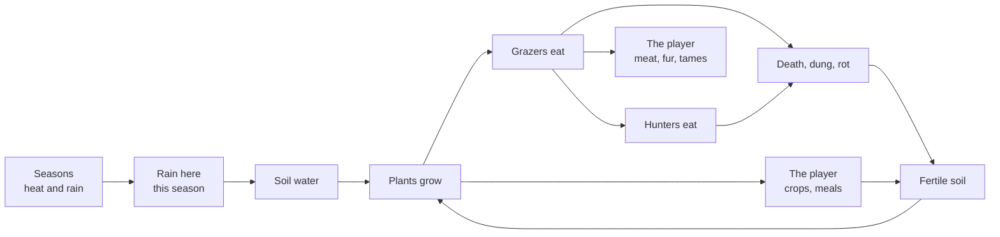

# The living world: one loop

Ronald, 2026-11-03: "it should be like a loop, like the life cycle works: rain creates crops,
crops feed animals, herbivores... same as seasons, the rainy part, the dry season. Everything is
connected. If we get everything balanced and connected in a cool way, it just feels realistic.
If we have it all mapped out from the beginning, it will be easier to build, and less code."

This is the design for the whole loop, before any of it is built: what each part is, what it
reads and what reads it, where its numbers live, the order to build it in, and the checks that
keep it balanced. It builds on what is there (`notes/SYSTEMS.md`) and on the decisions in
`notes/ANIMALS.md` ("Places, food and sedation": one hub, the place; food categories; condition
as the one number). The parts are on the map (`notes/overview/pieces.json`, "Living world").

## The loop

In one sentence each:

1. **The seasons bring heat and rain.** Each biome has a temperature and a rain share for every
   season: the savanna wet in summer and dry in winter, the desert dry all year, the swamp wet
   all year, the Cretaceous a wet and a dry half.
2. **Rain falls where it's the season for it.** A rain spell over the world falls in a biome as
   often as that biome's share this season; it's dry elsewhere.
3. **Rain wets the soil, heat dries it.** Each biome keeps one number, how wet its ground is,
   from the last few days' rain; ground next to water is always wet.
4. **Plants grow with warmth, water and light.** One rule for crops, wild plants and grass. In
   the cold or the dry season they rest, and berries fruit in their season.
5. **Grazers eat the plants.** Wild animals get hungry like tames. They graze grass, browse
   leaves and pick fruit by their diet, and drink. Well fed, they reach what their genes allow;
   poorly fed, they stay thin and weak (condition, built already).
6. **Hunters eat the grazers.** Carnivores hunt animals of a size they can take, and prey run.
7. **A place holds as many animals as it can feed.** New animals arrive, and are born in their
   breeding season, where there's food for them. In a dry season there are fewer and thinner
   ones.
8. **What dies and what's eaten goes back to the soil.** Carcasses and dropped food rot;
   animals leave dung. Rot, dung and old leaves make compost.
9. **Fertile soil grows more.** Crops tire farmland; compost, dung or a season left fallow
   restore it. That closes the loop back to step 4.

The player sits in the middle. They farm (steps 3, 4, 8, 9), hunt and herd (5, 6), and turn
animals into clothing (fur, leather and wool against the cold) and crops and meat into meals.

## Less code: the five shared things

The loop is many parts, but each reads a few shared things instead of having its own rules.
They are the whole design; everything else is a row in a table.

| Shared thing | What it is | Where it lives | Replaces |
|---|---|---|---|
| **The place** | Everything about a spot: today's `Air` (temperature, sky, rain, season), plus soil water and soil fertility | `base_api::air_at`, grown into `place_at` | each system asking the world on its own |
| **The climate table** | A biome's temperature, humidity and seasons (now), plus rain per season | `vitals::climate::BIOMES` | random weather |
| **The plant table** | Each plant: the warmth and water it grows in, its seasons, its growing time, what it gives as food and to which category | `vitals::plants` (new) | a growth time per block |
| **Food categories** | Grass, leaves, water plants, fruit, seeds, roots, lichen, fungi, insects, meat, fish, carrion, water. Each food item, each plant and each diet names its categories | `vitals::food` (a category on each row) | `Diet::{Carnivore, Herbivore}` and per-species item lists |
| **The forage goal** | One goal for every animal that's hungry or thirsty: find the nearest thing of its categories (a plant block, an item on the ground, water, prey), go there, eat | `mods/animals/src/forage.rs` (new), beside `comfort.rs` | separate grazing, hunting and drinking code |

Two further rules keep the code small:

- **Wild animals aren't simulated one by one far away.** There is no global count of rabbits.
  A place's capacity (how much its plants feed this season) sets how often animals spawn there
  and how full they arrive. Nearby, the real animals eat, hunt and starve. Arriving and leaving
  stand in for births and deaths far away, and breeding seasons bring babies.
- **Soil water is one number per biome, not per block.** Only farmland keeps its own state (its
  fertility, a block property), which the engine stores for free.

## From real places, like the species

Ronald: "for each species we always do research, and that feeds into the game. Don't we need the
same for biomes: how much rain, in which season? If we base it on real life, of course quicker,
it will probably work better." Yes. Real numbers come already balanced against each other: a
savanna's rain, its grass and its grazers fit because they grew up together. A species is a row
of real facts with one pacing turning them into game numbers (`animals_core::biology`), and the
loop works the same way.

- **Biomes:** each biome gets a real place of its kind, its type locality, with that place's
  climate normals:
  - the mean temperature month by month;
  - the rain in mm and the rainy days month by month;
  - the dry months, and snow cover.

  The plains are a prairie (Kansas), the savanna the llanos (Venezuela), the taiga central Siberia
  or Canada's boreal, the swamp the Okefenokee or the Pantanal, the desert Sonora (Chihuahua's
  own country), the snowy plains the tundra. The Cretaceous takes its formations' reconstructed
  climates (Djadokhta, Cedar Mountain). Today's `BIOMES` temperatures were set "as a real place
  of its kind" without saying which. The research names the place and the source for each.
- **Plants:** each plant gets real agronomy:
  - the base temperature it grows above and its best and highest;
  - its days to harvest;
  - the water it needs in mm a season;
  - how much it tires the soil.

  For wild grass and leaves, how much a hectare grows in a year in each biome, and in which
  months.
- **Animals:** each species gets what it really eats, in its real habitats and by season: the
  capybara's grasses and water plants, the wildcat's rodents, birds and insects, the raptors'
  prey from their formations' fossils. Also how much it eats a day (about 2-3% of its mass in
  dry matter for a grazer, less for a hunter), how much it drinks, and how far it goes for food.
  Most of the other species facts are there already.
- **The food list:** the diets decide what the world must have. Every real food a species eats
  becomes a category and a concrete plant, item or prey in its habitats, such as:
  - reeds and water hyacinth by the swamp's water;
  - rodents and small birds in the plains;
  - beetles under logs;
  - ferns and horsetails in the Cretaceous.

  With the crops' agronomy and the biomes' climates, this is the content plan for food. It says
  which plants, crops, small animals and items to add, where they grow and in which season. A
  check holds it to that (below).
- **The food web:** Ronald: "we need everything from the food chain, otherwise it doesn't work."
  The research gives each biome's real food web, from its real place: the plants, who eats them,
  who eats those, and what eats the dead. Each of our species gets its predators as well as its
  prey. A chihuahua is prey to hawks and coyotes, a capybara to jaguars, caimans and anacondas,
  a young raptor to a Utahraptor. The web's gaps are the species list: every level a biome needs
  that the game doesn't have yet.
  - **Three tiers, so a full web doesn't mean a hundred models:**
    - Full creatures, modelled and tameable, as today (the dogs, cats, capybaras, raptors).
    - Simple creatures with one model and few animations, that live, flee, breed and get eaten.
      These are the web's middle: rabbits, rodents, small birds, fish, frogs, deer, and the
      Cretaceous's small mammals, lizards and early birds.
    - Food sources in the world, not creatures: insects under logs and in rotten wood, worms in
      wet soil, fish as a catch in water. A forager finds them like a plant.
  - **The web as data:** a species' row gets `hunts` (prey by category and size, from part 6)
    and its tier. The web is then read from the rows, not written down a second time: who eats
    whom in each biome follows from the habitats, diets and sizes. The sheet draws it per biome.

  Each biome needs every level of its web: plants, grazers, hunters, and something for the dead
  (a carrion eater, or rot). A check holds it (below).
- **Pacing:** real to game in one place, as for species.
  - **The calendar:** a real year is the game's 56 days, so a month is about 4.7 game days and
    each season takes its three months.
  - **Shares carry over as they are:** "it rains on 20 of July's 31 days" means rain on two thirds
    of summer's days.
  - **Times are paced, and amounts follow area:** see "The pacing, worked out" below. Wheat ripens
    in the game as much sooner or later than a carrot as it does in a field.
- **Where it goes:** the research goes in `reports/` with its sources (as the species research
  did). The facts go in the tables (`vitals::climate`, `vitals::plants`, the species rows), and
  the pacing in one module that the game, the checks and the sheets all read.

## What the research found (2026-11-03)

There are four reports in `reports/ecology/`, each with sources and a data file the tables will be
filled from:
- `Biome climates.md` and `biome_climates.json`;
- `Plants and crops.md` and `plants.json`;
- `Overworld food webs.md` and `overworld_web.json`;
- `Cretaceous food webs.md` and `cretaceous_web.json`.

### Each biome's real place

| Biome | Place | Year °C | Rain mm | Wet / dry |
|---|---|---|---|---|
| plains | Manhattan, Kansas (Konza Prairie) | 12.8 | 909 | rain peaks May-Jun; dry winter |
| forest | Kassel, Germany (Białowieża for the animals) | 9.3 | 707 | even through the year |
| birch forest | Moscow | 6.3 | 713 | summer wettest |
| taiga | Fairbanks, Alaska | −2.1 | 296 | summer rain, a long snow winter |
| snowy plains | Utqiaġvik, Alaska | −10.2 | 137 | dry all year, snow 8-9 months |
| desert | Hermosillo, Sonora | 25.7 | 345 | the summer monsoon (Jul-Sep), a little winter rain |
| savanna | Arauca, the Colombian llanos | 26.9 | 1,868 | wet Apr-Nov, dry Dec-Mar |
| swamp | Nhumirim, the Pantanal (south: six months shifted) | 25.1 | 1,046 | wet Oct-Mar there: spring and summer in the game |
| mountains | Davos, 1,594 m | 4.0 | 1,046 | summer wettest, snow half the year |
| ocean | Ponta Delgada, Azores | 18.2 | 988 | wet winter, dry summer |
| beach | Faro, Portugal | 18.2 | 455 | wet winter, dry summer |
| deep caves | the rule: the surface's year mean, humidity 90-100% | | | |
| red dunes | the Djadokhta Formation (estimates) | ~17 | ~175 | short humid winters and springs, hot dry summers |
| scrubland | the Barun Goyot or Bayan Mandahu (estimates) | ~17 | ~350 | a summer wet season |
| floodplain | the Cedar Mountain Formation (estimates) | ~21 | ~800 | a monsoon: wet Jun-Sep, dry Nov-Apr |
| fern forest | the Yixian Formation, Liaoning (decided below) | ~10 | | cool, cold winters |
| crags | the Sevier highlands, by lapse rate (estimate) | ~13 | ~850 | |

**What changes in today's `climate.rs`:**
- **Swamp:** 6 °C warmer (25, not 19).
- **Red dunes and scrubland:** about 10 °C cooler and more seasonal. No source supports 28 °C; a
  dune field at 40-45° N had hot summers and cold winters.
- **Ocean:** 4 °C warmer for the Azores, or kept at 14 for a cooler sea.
- **The tropical places:** their seasons are rain, not heat. The savanna swings ±1.6 °C (today
  ±4), the Pantanal ±3.4 (today ±8).
- **Smaller corrections:**
  - the forest is about 1.7 °C too warm and the birch forest 2.7 °C;
  - the caves' humidity should be 0.95;
  - the floodplain's humidity of 0.8 is too wet for its semi-arid soils.
- **The day-night swing:** `temperature.rs` swings 4-12 °C, but the real places swing ±2.7 °C
  (the Azores) to ±7.8 °C (Hermosillo). A swing of `2.5 + 6.5 × (1 − humidity)` fits them with
  today's humidities.

### Plants and crops

- **Three groups by warmth:**
  - Cool-season crops (wheat, barley, rye, carrot, beet, potato) grow from 0-7 °C and suffer above
    30.
  - Warm-season crops (maize, beans, squash, melon, rice, sorghum) need about 10 °C and die in
    frost.
  - Tropical crops (sugar cane, cassava, millet) need 12-15 °C or more.
- **Over winter:** only winter wheat and rye survive it in the field, and they need the cold to
  set grain.
- **Grass and its regrowth:** a year's grass in kg of dry matter per hectare, from the real places:
  - prairie 3,940;
  - llanos 3,750, all of it May to November;
  - Pantanal about 4,500;
  - Sonoran desert about 900, in two pulses;
  - tundra 320 to 3,050.

  Grass regrows from grazing in 15-21 days in spring and in 90-100 in winter.
- **Gaps that matter for food chains:**
  - grass seeds in the plains (for mice and birds);
  - acorns in the forest (heavy crops every 3-4 years);
  - lichen, sedges and cottongrass in the tundra, which has almost nothing to eat now;
  - mesquite pods, prickly pear and cactus fruit in the desert;
  - water hyacinth, sedges, wild rice and palms in the swamp and llanos.

  After those come lingonberry, mushrooms and willow in the taiga, pine nuts in the mountains,
  and kelp on the coast.
- **Crops to add by biome:**
  - barley and rye in the taiga;
  - cassava, maize and rice in the llanos;
  - tepary beans, maize and squash in the desert;
  - clover for the soil.
- **The Cretaceous had no grass.** The oldest grass known is 113-101 million years old, and rare.
  Its ground cover was ferns and horsetails: grazers there eat the fern and horsetail blocks as
  their grass. The best foods were horsetails, *Araucaria* and *Ginkgo*; cycads and tree ferns
  were poor.
- **Cretaceous plants to add:** cycads, the tree fern *Tempskya*, swamp conifers and rotten logs
  (for grubs).

### The food webs and the species to add

Every biome's web is whole with the set below (checked against the data: plants, grazers,
hunters and something for the dead in each). Predators limit their prey but rarely set its
numbers; food and winter do.

**Overworld:**
- **Tier 1, full creatures, new:**
  - the **wolf**: the top hunter of forests, taiga, tundra and mountains, and the dog's
    ancestor, so a natural tame;
  - the **jaguar**: the savanna's and swamp's top hunter, which in the Pantanal eats mostly caiman
    and fish.
- **The farm animals as wild forms of their own models:** cow as bison, pig as wild boar or
  peccary, sheep as ibex or bighorn, chicken as the local grouse or quail (the red junglefowl is
  Asian, in none of our places).
- **Tier 2, simple creatures (14):**
  - grazers and prey: hare, rodent, small bird, deer, reindeer, fish;
  - hunters: caiman, fox, coyote, eagle, owl;
  - for the dead: vulture, raven, gull.

  They are widely shared. The fox covers ten biomes as the red, kit, Arctic or crab-eating fox,
  and does more for the webs than any other one species. The rodent, small bird, eagle and owl
  cover every land biome.
- **Later, since no web needs them:** lynx, puma, bear, moose, frog, lizard, snake (anaconda),
  heron, seal.
- **Tier 3, food sources:** insects, grubs in rotten wood, worms in wet soil, shellfish, eggs in
  nests, fish as a catch, carrion.

**Cretaceous:**
- **Tier 1, new:**
  - ***Protoceratops***, which dominated the dunes and was the Velociraptor's prey;
  - an **iguanodont** (*Iguanacolossus*), the floodplain's and forest's big herbivore, which can
    start as tier 2.
- **Tier 2:**
  - an ankylosaur, *Pinacosaurus* in the Gobi and *Gastonia* in Utah on one model;
  - a sauropod, *Cedarosaurus*;
  - *Citipati*, the oviraptorid that brooded its nests;
  - *Psittacosaurus*;
  - a small mammal (*Kryptobaatar*) and a lizard in every biome;
  - an early bird, *Confuciusornis* or *Gobipteryx* on one model;
  - a crocodyliform, the water's hunter.
- **Tier 3:** beetles in wood and dung, termite nests, carrion insects, fish (lungfish,
  *Lycoptera*), eggs, carcasses.

**Wave one:** the smallest set that makes the loop visible when hunters come (step 5). That is
hare, rodent, deer, fish, fox and raven in the overworld, and *Protoceratops*, the small mammal
and the lizard in the Cretaceous. The rest follow biome by biome.

### What it changed in this design

- **Food categories:** water plants, lichen and fungi joined them (part 4).
- **Diets:** the chihuahua is a scavenger first (free-ranging dogs live 60-83% on what people
  and carcasses leave).
- **Prey size:** each species gets its own prey-size range instead of one rule (part 6).
- **Water:** each species gets its own water need (part 4).
- **Hunting and capacity:** the numbers for how much hunters take and what a place carries are in
  parts 6 and 7.
- **Fertility:** 0 still grows at a fifth of the rate, and clover, not beans, is the soil-feeder
  (part 9).
- **The species rows:** V. osmolskae's real home, Bayan Mandahu, is the scrubland's model, so its
  habitats should add the scrubland. The Utahraptor's rock is now dated about 139-134 million
  years old, older than once thought.

## The pacing, worked out

There are two clocks. Both already exist, so the loop only reuses them.

- **The climate's clock is the calendar.** A real year is the game's 56-day year, so a real day
  is 0.15 game days and a month is 4.7. Everything the weather does is read month by month from
  the real place and spread over that month's 4.7 game days:
  - rain: the share of days with rain carries over as it is;
  - temperature: as now;
  - soil drying: a month's water balance over its game days.

  So the seasons last as long as they do in life, compared with the year.
- **Living things use the species' growing pace**, game days = 0.0645 · real days^0.7
  (`animals_core::biology::GROWING`, the pace a puppy grows up by). Crops use it too, so a field
  and a litter keep the same proportions they have in life:

  | | real days | game days | real-time minutes |
  |---|---|---|---|
  | radish | 30 | 0.7 | 14 |
  | carrot | 70 | 1.3 | 25 |
  | potato | 100 | 1.6 | 32 |
  | spring wheat | 110 | 1.7 | 35 |
  | maize | 120 | 1.8 | 37 |
  | sugar cane | 365 | 4.0 | 80 |
  | an apple tree, to its first fruit | 1460 | 10.6 | 212 |
  | a dog, to grown | 300 | 3.5 | 70 |

  That is close to how long a block game's crops take now (wheat about 24 minutes today). It
  also gives several harvests in a 14-day season. The season decides **whether** a plant grows,
  and the pace decides **how fast**: in the dry season or in winter nothing grows, in the rains
  wheat ripens in under two days, and a slow tree takes most of a season.
- **Amounts follow area, not time.** How many animals a place feeds is forage per area over
  intake per animal, and both are per real year, so the clock drops out. Real densities give the
  ratios between species and biomes. The one tuning number is a single boost for how much fuller
  than life the game shows its land (a deer every 100 blocks would look empty), and it's the same
  for every species and biome, so the ratios stay real.
- **Found on the way:** lifespans run on a faster pace than the calendar
  (`LIVING`: a dog's 13 years are 50 game days, under one game year). That's on purpose, since a
  player sees generations, and it's fine for the loop: seasons and lifespans don't need the same
  clock. But it means an animal lives about one year of seasons, so each breeding season is most
  of its life's chance. The breeding and population checks should keep that in mind.

## The parts

### 1. Rain by season

**Built (2026-11-03).**
- **The table:** `vitals::climate::BIOMES` holds each real place's rain per season and its
  temperatures, and `temperature::air`'s day swing is fitted to the real places.
- **The driver:** `mods/base/src/weather.rs` works out where it rains a few times a minute and
  tells the engine (`set_rain`).
- **The engine:** it draws rain only in those biomes, and the sky greys only where you stand in
  it. `/weather` still rains everywhere for its time, and `raining_at` tells mods whether it's
  raining here.
- **`/rain`** says today's spell where you stand.
- **Checks:** `vitals/tests/places.rs` holds the table to the research, and a unit test checks
  that spells follow the shares.
- **Seen in the game:** the plains, summer day 2, rain from 17:00 to 22:00 (24 °C, wet) and dry
  at noon (30 °C).
- **Not yet:**
  - rain falls as snow only where a biome is tagged snowy, so a taiga winter spell is drawn as
    rain, though bodies feel snow (air under 1 °C);
  - the Cretaceous's "wet season" label is still the calendar's, not each biome's;
  - not yet seen at a border between a wet and a dry biome.

- **Climate table:** each row gets `rain: [f32; 4]`, the share of days with rain in spring,
  summer, autumn and winter. These come from real places of the biome's kind, as the
  temperatures did (the savanna from the llanos; the floodplain from Utah's Cretaceous).
- **Weather:** our mod drives the world's rain spells (the SDK has `set_weather`). A spell starts
  more often when the season is wet over most of the land.
- **Rain at a place:** it rains here if a spell is on and this biome's roll for that spell beats
  its share this season (a hash of the spell and the biome, so every machine agrees). `Air`
  already has `raining` and `snowing`, so bodies, eggs and comfort follow it with no other change.
- **Engine:** the one change. Rain and snow are drawn per column, with a biome's `snowy` tag
  deciding which (`crates/engine/src/client/weather.rs`). It needs a per-biome "dry now" flag that
  the server sends when it changes, so no rain is drawn in a dry biome. The deep-cave and
  underground rules stay as they are.
- **Shows:** the sky, the HUD's weather and season, and the sheet's climate table with rain per
  season.

### 2. Soil water

- **The rule:** each biome's `wet` goes up a step on a rainy day and down with heat on a dry one.
  From 0 to 1, it's kept per dimension and biome, and saved with the world's rules.
- **Near water:** ground within 4 blocks of water counts as wet whatever the season. This is how
  farmland works now, and it's why rivers and swamps stay green.
- **Shows:** later, the grass colour follows it (green in the rains, yellow-brown in the dry
  season). That needs a per-biome tint that can change, an engine question for the look.

### 3. Plants grow by the place

- **The plant table:** one row per plant:
  - the warmth it grows in (`min`, `best`, `max` °C);
  - its water need (dry, moderate or wet);
  - its seasons (when it grows, and when it fruits);
  - its growing time on the year's calendar;
  - what it gives (item, amount, food category);
  - whether it tires the soil (a crop) or feeds it (beans, clover).

  Wheat, carrots, potatoes, beetroot, berries, grass, ferns, saplings, sugar cane and cactus.
- **The rule:** a growth step goes ahead at the rate `warmth × water × light × fertility`, each
  0 to 1, from the place and the table. The engine's `.growth(..)` already spreads steps over time
  and catches up on unloaded areas; a step only asks the rate. Catching up uses the season's
  average, not each day.
- **Grass is a plant too:** grazing takes the tall grass on top (or turns grass to dirt for the
  biggest grazers), and it grows back by the same rule. A dry season means slow regrowth, so
  grazing gets scarce on its own.
- **Leaves and fruit:** browsers eat leaves (a little, without breaking the tree), and berry
  bushes fruit only in their season.
- **Shows:** crops that stall in winter or a drought and green up in the rains, and a planting
  calendar the player learns (the sheet lists it).

### 4. Food categories and diets

- **The categories:** grass, leaves, water plants, fruit, seeds, roots, lichen, fungi, insects, meat, fish, carrion and water. Water plants, lichen and fungi came from the research: the capybara lives on water plants, reindeer on lichen in winter, and the taiga's fungi feed rodents and boar.
- **Food rows:** each row in `vitals::food::FOODS` gets its category, and each plant gives one.
  That covers player foods, items and plants.
- **Species rows:** each species gets `eats: &[Category]` with its favourites. Its taming foods
  follow from that, and the per-species item lists shrink to the exceptions (kibble). From the
  research:
  - **chihuahua:** meat, carrion, insects, fruit, seeds; semi-wild dogs are scavengers first;
  - **cat:** meat, with insects, carrion and fish;
  - **capybara:** grass, water plants, fruit;
  - **the raptors:** meat with a quarter carrion;
  - **the Utahraptor and the wyvern:** meat, carrion, fish.
- **Water:** for animals, water is a category too (they drink at water blocks). For the player it
  is a nutrient already. Desert animals barely drink: kangaroo rats never do, and kit foxes and
  wildcats get their water from prey. So a species' row says how much of its water it drinks
  (mammals need about 0.099 · mass^0.9 litres a day), or desert animals would crowd the few pools.

### 5. Wild hunger and the forage goal

- **Hunger:** wild animals get the food meter tames have, using it up at the species' rate.
  Out of comfort it goes faster, as for tames (`comfort::upkeep`).
- **The goal:** under half, the forage goal looks within its range for the nearest target of
  its categories, goes there and eats.
  - **Targets:** a plant block of the right category, an item on the ground (dropped food,
    carrion), water, or prey.
  - **Order of goals:** hold (commands) > flee > comfort > forage > wander.
- **Feeding back:** a full meter feeds condition (built), which sets health, speed and growth.
  So a dry season reaches stats through food alone.
- **Tames:** they forage too when not told to stay, so a pasture feeds a herd. Troughs come with
  care for tames.

### 6. Hunters and prey

- **What a hunter takes:** each species' own prey-size range, from its research. Hunters under
  about 21.5 kg (chihuahua, cat, fox) mostly take prey under half their mass and many insects;
  bigger ones take prey their own size and more. A Velociraptor alone took on a *Protoceratops*
  about five times its mass (the Fighting Dinosaurs fossil), so no rule fits every hunter. The
  range is a fact in the row.
- **Prey:** an animal flees what would hunt it, which widens today's `scares` (players) to
  predators. It flees sooner when it's alert (a herd, by day).
- **A kill:** it leaves a carcass: meat items on the ground, eaten on the spot by the hunter and
  later by carrion eaters, rotting if left. Hunters stop when full, so prey aren't wiped out.
- **How much hunters take:** in life, one predator species takes 10-36% of a prey's numbers a
  year. A big solitary hunter kills every 4-7 days, and there's about 1 kg of hunter per 100 kg
  of its prey. Food and winter set numbers more than hunters do (part 7).
- **Players:** a hunter takes them by the same rule (a raptor pack hunts a player; a cat
  doesn't). Tame hunters hunt for their tribe if told to.

### 7. Capacity and populations

- **Capacity:** a place's capacity for a species is how much of its food categories the
  biome's plants (or, for hunters, its grazers) give this season, against how much one animal
  eats.
  - **Grazers:** wild grazers eat about 18% of a year's plant growth (median), and a grazer eats
    2-3% of its mass a day in dry matter.
  - **Hunters:** hunters weigh about 0.009 of their prey's biomass, and about 10% of energy
    reaches each level up.
  - **Without predators** grazers overshoot and crash, as on St. Matthew Island (29 reindeer,
    then 6,000, then 42). Starving and capacity make that happen without extra rules.
- **Spawning:** spawning in a habitat scales with capacity, and stops when that many are already
  near. They arrive fed by it: well fed in the rains, thin in a drought.
- **Births:** in its breeding season some spawns are young with their mother.
- **Starving:** an animal starving for long enough dies, so an overgrazed or drought-struck spot
  empties.
- **Shows:** the spyglass and the animal screen ("thin: little to eat here this season"), and
  `/animal habitats` gets capacity per season.

### 8. Death, dung and rot

- **Carcasses:** a dead animal leaves meat and bones (as now). Food on the ground rots through
  its freshness (built for items), and at the end it becomes spoiled food.
- **Dung:** grazers drop dung now and then, more after eating.
- **The compost bin:** a block. It takes spoiled food, dung, leaves and plant waste, and after a
  few days gives compost. Bones still make bone meal.
- **Nothing piles up:** items on the ground rot away, and what's eaten is gone.

### 9. Fertile soil

- **Fertility:** farmland gets a property, fertility 0 to 3, starting at 2. At 0 it still grows a
  fifth as fast: the Rothamsted wheat plot, unfertilised since 1843, still gives about 1 t/ha
  against 6-7 with manure.
  - **Lowering it:** a harvest of a crop that tires the soil lowers it by one.
  - **Raising it:** compost or dung raises it by one, and so does a crop that feeds the soil
    when harvested: clover most (80-540 kg of nitrogen a hectare), beans a little (20-60). A season left unplanted brings back one in the rains.
- **Plants:** fertility goes into the growth rate (part 3). So rotation, manure and fallow are
  real choices, with no extra rules.

### The player's links (in Survival already)

- **Clothing:** fur, leather and wool give warmth without armour value (the open core part).
  Clothing is what turns hunting and herding into surviving the winter.
- **Meals:** several ingredients cooked together (the "freshness and cooking" core part). This is
  what turns farming into being well fed.
- **Care for tames:** troughs, barns and pasture (in Animals).

## Later, once the loop runs

- **Migration:** herds move towards wetter biomes in the dry season. The comfort goal's "seek a
  place", with water and food as the target.
- **Waterholes:** they shrink in the dry season, so animals gather at the rest.
- **The seasons' look:** grass by soil water, autumn leaves and winter snow.
- **Wildfire:** dry grass in the dry season burns and grows back greener.
- **Allen's and Gloger's rules:** see Animals.

## Building it, in order

Each step closes a smaller loop and can be played on its own.

0. **The research**: a real place for each biome with its climate normals and food web; real
   agronomy for each plant; real diet, intake, predators and prey for each species; the
   pacing. Written up in `reports/`, then the tables. It ends in the content list: which plants,
   crops, items and species (by tier) to add, and where. Every step below reads it.
1. **Rain by season**: the climate table, the weather driver, rain at a place, the engine's dry
   flag. Then the savanna's dry season shows.
2. **Plants by the place, and soil water**: the plant table and one growth rule for crops,
   berries and grass. Rain now grows things.
3. **Categories, diets, wild hunger and foraging**: grazers eat and drink, and condition follows
   the season. Plants now feed animals.
4. **Capacity**: spawning by food, thin in a drought.
5. **Hunters and prey**: fleeing, hunting and carcasses.
6. **Rot, dung, compost and fertility**: the loop is closed.
7. **The player's links**: clothing and meals, in Survival's order.

## The checks that keep it balanced

These are like `places.rs`: they read the tables, so a new biome, plant or species is checked
the moment it's added.

- **Every biome matches its real place**: its year of temperature and rain, through the
  pacing, stays near the place's normals (the table can't drift from the research). Its
  humidity follows its rain.
- **Every crop and wild plant grows somewhere** in its season (warmth and water at its best in
  at least one biome for part of the year).
- **Every species finds its food** in each of its habitats in every season: some plant or prey of
  its categories gives something there. A hunter needs prey that lives where it does. And
  every food in a species' researched diet exists in the game as a plant, item or prey.
- **Every biome's food web is whole**: it has plants, something that eats them, something that
  hunts those, and something for the dead. Every hunter has prey there, and every species
  except the top hunters has a predator somewhere in its habitats, so nothing multiplies
  unchecked.
- **A year in each biome holds** (`vitals::balance`-style simulation, day by day: rain, soil
  water, plant food, capacity per species). No species' capacity stays at 0 for a whole season
  where it lives, and grazers can't eat a biome bare in its best season.
- **The sheets:** the climate table gets rain per season, plus a plant table (where and when
  each grows) and a "who eats what where" table, generated like the rest.

## Open questions

Decided (Ronald, 2026-11-03), from the research:
- **The fern forest** follows the Yixian Formation (China, ~125 million years ago): conifers
  over ferns and the best-known food web, cool (about 10 °C) with cold winters. It's the
  Cretaceous's cool, misty biome. The climate report's Kaiparowits numbers are set aside.
- **The red dunes' wet season** is winter and spring, from the Djadokhta's own soils: ponds fill
  in spring, when *Protoceratops* nest and the raptors breed. The scrubland's is summer, towards
  the Nemegt.
- **The floodplain** keeps both layers of the Cedar Mountain Formation: the Yellow Cat's animals
  and the Ruby Ranch's climate numbers, both monsoonal.
- **Wild Velociraptors hunt alone**, as the fossils say (`Social::Solitary`). Utahraptors keep
  their packs.
- **Temperatures follow the real places:**
  - the swamp is warmer;
  - the dunes and scrubland are cooler, with real winters;
  - the tropical places' seasons are rain, not heat.

  The comfort and egg checks (`places.rs`) will show which species' ranges have to move with
  them.

Still open:
- Should a dry biome show its dry season in the grass colour from the start (an engine tint
  change), or after the loop runs?
- The biggest grazers turning grass to dirt: lively, or too much damage near a player's base?
- Do tames forage on their own by default, or only when told to graze?
