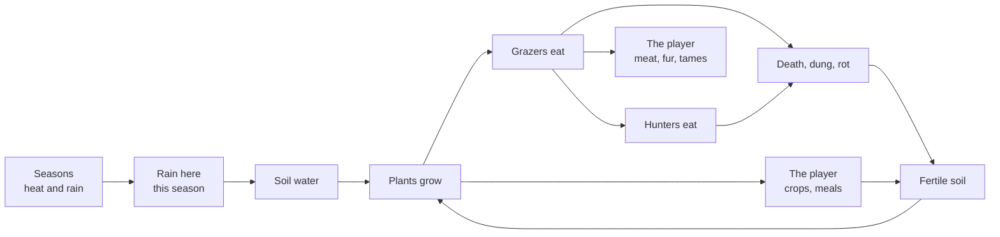

# The living world: one loop

Ronald, 2026-11-03: "it should be like a loop, like the life cycle works: rain creates crops,
crops feed animals, herbivores... same as seasons, the rainy part, the dry season. Everything is
connected. If we get everything balanced and connected in a cool way, it just feels realistic.
If we have it all mapped out from the beginning, it will be easier to build, and less code."

This is the design for the whole loop, before any of it is built: what each part is, what it
reads and what reads it, where its numbers live, the order to build it in, and the checks that
keep it balanced. It builds on what is there (`notes/SYSTEMS.md`) and on the decisions in
`notes/ANIMALS.md` ("Places, food and sedation": one hub, the place; food categories; condition
as the one number). The parts are on the map (`notes/overview/pieces.json`, "Living world").

## The loop

In one sentence each:

1. **The seasons bring heat and rain.** Each biome has a temperature and a rain share for every
   season: the savanna wet in summer and dry in winter, the desert dry all year, the swamp wet
   all year, the Cretaceous a wet and a dry half.
2. **Rain falls where it's the season for it.** A rain spell over the world falls in a biome as
   often as that biome's share this season; it's dry elsewhere.
3. **Rain wets the soil, heat dries it.** Each biome keeps one number, how wet its ground is,
   from the last few days' rain; ground next to water is always wet.
4. **Plants grow with warmth, water and light.** One rule for crops, wild plants and grass. In
   the cold or the dry season they rest, and berries fruit in their season.
5. **Grazers eat the plants.** Wild animals get hungry like tames. They graze grass, browse
   leaves and pick fruit by their diet, and drink. Well fed, they reach what their genes allow;
   poorly fed, they stay thin and weak (condition, built already).
6. **Hunters eat the grazers.** Carnivores hunt animals of a size they can take, and prey run.
7. **A place holds as many animals as it can feed.** New animals arrive, and are born in their
   breeding season, where there's food for them. In a dry season there are fewer and thinner
   ones.
8. **What dies and what's eaten goes back to the soil.** Carcasses and dropped food rot;
   animals leave dung. Rot, dung and old leaves make compost.
9. **Fertile soil grows more.** Crops tire farmland; compost, dung or a season left fallow
   restore it. That closes the loop back to step 4.

The player sits in the middle. They farm (steps 3, 4, 8, 9), hunt and herd (5, 6), and turn
animals into clothing (fur, leather and wool against the cold) and crops and meat into meals.

## Less code: the five shared things

The loop is many parts, but each reads a few shared things instead of having its own rules.
They are the whole design; everything else is a row in a table.

| Shared thing | What it is | Where it lives | Replaces |
|---|---|---|---|
| **The place** | Everything about a spot: today's `Air` (temperature, sky, rain, season), plus soil water and soil fertility | `base_api::air_at`, grown into `place_at` | each system asking the world on its own |
| **The climate table** | A biome's temperature, humidity and seasons (now), plus rain per season | `vitals::climate::BIOMES` | random weather |
| **The plant table** | Each plant: the warmth and water it grows in, its seasons, its growing time, what it gives as food and to which category | `vitals::plants` (new) | a growth time per block |
| **Food categories** | Grass, leaves, water plants, fruit, seeds, roots, lichen, fungi, insects, meat, fish, carrion, water. Each food item, each plant and each diet names its categories | `vitals::food` (a category on each row) | `Diet::{Carnivore, Herbivore}` and per-species item lists |
| **The forage goal** | One goal for every animal that's hungry or thirsty: find the nearest thing of its categories (a plant block, an item on the ground, water, prey), go there, eat | `mods/animals/src/forage.rs` (new), beside `comfort.rs` | separate grazing, hunting and drinking code |

Two further rules keep the code small:

- **Wild animals aren't simulated one by one far away.** There is no global count of rabbits.
  A place's capacity (how much its plants feed this season) sets how often animals spawn there
  and how full they arrive. Nearby, the real animals eat, hunt and starve. Arriving and leaving
  stand in for births and deaths far away, and breeding seasons bring babies.
- **Soil water is one number per biome, not per block.** Only farmland keeps its own state (its
  fertility, a block property), which the engine stores for free.

## From real places, like the species

Ronald: "for each species we always do research, and that feeds into the game. Don't we need the
same for biomes: how much rain, in which season? If we base it on real life, of course quicker,
it will probably work better." Yes. Real numbers come already balanced against each other: a
savanna's rain, its grass and its grazers fit because they grew up together. A species is a row
of real facts with one pacing turning them into game numbers (`animals_core::biology`), and the
loop works the same way.

- **Biomes:** each biome gets a real place of its kind, its type locality, with that place's
  climate normals:
  - the mean temperature month by month;
  - the rain in mm and the rainy days month by month;
  - the dry months, and snow cover.

  The plains are a prairie (Kansas), the savanna the llanos (Venezuela), the taiga central Siberia
  or Canada's boreal, the swamp the Okefenokee or the Pantanal, the desert Sonora (Chihuahua's
  own country), the snowy plains the tundra. The Cretaceous takes its formations' reconstructed
  climates (Djadokhta, Cedar Mountain). Today's `BIOMES` temperatures were set "as a real place
  of its kind" without saying which. The research names the place and the source for each.
- **Plants:** each plant gets real agronomy:
  - the base temperature it grows above and its best and highest;
  - its days to harvest;
  - the water it needs in mm a season;
  - how much it tires the soil.

  For wild grass and leaves, how much a hectare grows in a year in each biome, and in which
  months.
- **Animals:** each species gets what it really eats, in its real habitats and by season: the
  capybara's grasses and water plants, the wildcat's rodents, birds and insects, the raptors'
  prey from their formations' fossils. Also how much it eats a day (about 2-3% of its mass in
  dry matter for a grazer, less for a hunter), how much it drinks, and how far it goes for food.
  Most of the other species facts are there already.
- **The food list:** the diets decide what the world must have. Every real food a species eats
  becomes a category and a concrete plant, item or prey in its habitats, such as:
  - reeds and water hyacinth by the swamp's water;
  - rodents and small birds in the plains;
  - beetles under logs;
  - ferns and horsetails in the Cretaceous.

  With the crops' agronomy and the biomes' climates, this is the content plan for food. It says
  which plants, crops, small animals and items to add, where they grow and in which season. A
  check holds it to that (below).
- **The food web:** Ronald: "we need everything from the food chain, otherwise it doesn't work."
  The research gives each biome's real food web, from its real place: the plants, who eats them,
  who eats those, and what eats the dead. Each of our species gets its predators as well as its
  prey. A chihuahua is prey to hawks and coyotes, a capybara to jaguars, caimans and anacondas,
  a young raptor to a Utahraptor. The web's gaps are the species list: every level a biome needs
  that the game doesn't have yet.
  - **Three tiers, so a full web doesn't mean a hundred models:**
    - Full creatures, modelled and tameable, as today (the dogs, cats, capybaras, raptors).
    - Simple creatures with one model and few animations, that live, flee, breed and get eaten.
      These are the web's middle: rabbits, rodents, small birds, fish, frogs, deer, and the
      Cretaceous's small mammals, lizards and early birds.
    - Food sources in the world, not creatures: insects under logs and in rotten wood, worms in
      wet soil, fish as a catch in water. A forager finds them like a plant.
  - **The web as data:** a species' row gets `hunts` (prey by category and size, from part 6)
    and its tier. The web is then read from the rows, not written down a second time: who eats
    whom in each biome follows from the habitats, diets and sizes. The sheet draws it per biome.

  Each biome needs every level of its web: plants, grazers, hunters, and something for the dead
  (a carrion eater, or rot). A check holds it (below).
- **Pacing:** real to game in one place, as for species.
  - **The calendar:** a real year is the game's 56 days, so a month is about 4.7 game days and
    each season takes its three months.
  - **Shares carry over as they are:** "it rains on 20 of July's 31 days" means rain on two thirds
    of summer's days.
  - **Times are paced, and amounts follow area:** see "The pacing, worked out" below. Wheat ripens
    in the game as much sooner or later than a carrot as it does in a field.
- **Where it goes:** the research goes in `reports/` with its sources (as the species research
  did). The facts go in the tables (`vitals::climate`, `vitals::plants`, the species rows), and
  the pacing in one module that the game, the checks and the sheets all read.

## What the research found (2026-11-03)

There are four reports in `reports/ecology/`, each with sources and a data file the tables will be
filled from:
- `Biome climates.md` and `biome_climates.json`;
- `Plants and crops.md` and `plants.json`;
- `Overworld food webs.md` and `overworld_web.json`;
- `Cretaceous food webs.md` and `cretaceous_web.json`.

### Each biome's real place

| Biome | Place | Year °C | Rain mm | Wet / dry |
|---|---|---|---|---|
| plains | Manhattan, Kansas (Konza Prairie) | 12.8 | 909 | rain peaks May-Jun; dry winter |
| forest | Kassel, Germany (Białowieża for the animals) | 9.3 | 707 | even through the year |
| birch forest | Moscow | 6.3 | 713 | summer wettest |
| taiga | Fairbanks, Alaska | −2.1 | 296 | summer rain, a long snow winter |
| snowy plains | Utqiaġvik, Alaska | −10.2 | 137 | dry all year, snow 8-9 months |
| desert | Hermosillo, Sonora | 25.7 | 345 | the summer monsoon (Jul-Sep), a little winter rain |
| savanna | Arauca, the Colombian llanos | 26.9 | 1,868 | wet Apr-Nov, dry Dec-Mar |
| swamp | Nhumirim, the Pantanal (south: six months shifted) | 25.1 | 1,046 | wet Oct-Mar there: spring and summer in the game |
| mountains | Davos, 1,594 m | 4.0 | 1,046 | summer wettest, snow half the year |
| ocean | Ponta Delgada, Azores | 18.2 | 988 | wet winter, dry summer |
| beach | Faro, Portugal | 18.2 | 455 | wet winter, dry summer |
| deep caves | the rule: the surface's year mean, humidity 90-100% | | | |
| red dunes | the Djadokhta Formation (estimates) | ~17 | ~175 | short humid winters and springs, hot dry summers |
| scrubland | the Barun Goyot or Bayan Mandahu (estimates) | ~17 | ~350 | a summer wet season |
| floodplain | the Cedar Mountain Formation (estimates) | ~21 | ~800 | a monsoon: wet Jun-Sep, dry Nov-Apr |
| fern forest | the Yixian Formation, Liaoning (decided below) | ~10 | | cool, cold winters |
| crags | the Sevier highlands, by lapse rate (estimate) | ~13 | ~850 | |

**What changes in today's `climate.rs`:**
- **Swamp:** 6 °C warmer (25, not 19).
- **Red dunes and scrubland:** about 10 °C cooler and more seasonal. No source supports 28 °C; a
  dune field at 40-45° N had hot summers and cold winters.
- **Ocean:** 4 °C warmer for the Azores, or kept at 14 for a cooler sea.
- **The tropical places:** their seasons are rain, not heat. The savanna swings ±1.6 °C (today
  ±4), the Pantanal ±3.4 (today ±8).
- **Smaller corrections:**
  - the forest is about 1.7 °C too warm and the birch forest 2.7 °C;
  - the caves' humidity should be 0.95;
  - the floodplain's humidity of 0.8 is too wet for its semi-arid soils.
- **The day-night swing:** `temperature.rs` swings 4-12 °C, but the real places swing ±2.7 °C
  (the Azores) to ±7.8 °C (Hermosillo). A swing of `2.5 + 6.5 × (1 − humidity)` fits them with
  today's humidities.

### Plants and crops

- **Three groups by warmth:**
  - Cool-season crops (wheat, barley, rye, carrot, beet, potato) grow from 0-7 °C and suffer above
    30.
  - Warm-season crops (maize, beans, squash, melon, rice, sorghum) need about 10 °C and die in
    frost.
  - Tropical crops (sugar cane, cassava, millet) need 12-15 °C or more.
- **Over winter:** only winter wheat and rye survive it in the field, and they need the cold to
  set grain.
- **Grass and its regrowth:** a year's grass in kg of dry matter per hectare, from the real places:
  - prairie 3,940;
  - llanos 3,750, all of it May to November;
  - Pantanal about 4,500;
  - Sonoran desert about 900, in two pulses;
  - tundra 320 to 3,050.

  Grass regrows from grazing in 15-21 days in spring and in 90-100 in winter.
- **Gaps that matter for food chains:**
  - grass seeds in the plains (for mice and birds);
  - acorns in the forest (heavy crops every 3-4 years);
  - lichen, sedges and cottongrass in the tundra, which has almost nothing to eat now;
  - mesquite pods, prickly pear and cactus fruit in the desert;
  - water hyacinth, sedges, wild rice and palms in the swamp and llanos.

  After those come lingonberry, mushrooms and willow in the taiga, pine nuts in the mountains,
  and kelp on the coast.
- **Crops to add by biome:**
  - barley and rye in the taiga;
  - cassava, maize and rice in the llanos;
  - tepary beans, maize and squash in the desert;
  - clover for the soil.
- **The Cretaceous had no grass.** The oldest grass known is 113-101 million years old, and rare.
  Its ground cover was ferns and horsetails: grazers there eat the fern and horsetail blocks as
  their grass. The best foods were horsetails, *Araucaria* and *Ginkgo*; cycads and tree ferns
  were poor.
- **Cretaceous plants to add:** cycads, the tree fern *Tempskya*, swamp conifers and rotten logs
  (for grubs).

### The food webs and the species to add

Every biome's web is whole with the set below (checked against the data: plants, grazers,
hunters and something for the dead in each). Predators limit their prey but rarely set its
numbers; food and winter do.

**Overworld:**
- **Tier 1, full creatures, new:**
  - the **wolf**: the top hunter of forests, taiga, tundra and mountains, and the dog's
    ancestor, so a natural tame;
  - the **jaguar**: the savanna's and swamp's top hunter, which in the Pantanal eats mostly caiman
    and fish.
- **The farm animals as wild forms of their own models:** cow as bison, pig as wild boar or
  peccary, sheep as ibex or bighorn, chicken as the local grouse or quail (the red junglefowl is
  Asian, in none of our places).
- **Tier 2, simple creatures (14):**
  - grazers and prey: hare, rodent, small bird, deer, reindeer, fish;
  - hunters: caiman, fox, coyote, eagle, owl;
  - for the dead: vulture, raven, gull.

  They are widely shared. The fox covers ten biomes as the red, kit, Arctic or crab-eating fox,
  and does more for the webs than any other one species. The rodent, small bird, eagle and owl
  cover every land biome.
- **Later, since no web needs them:** lynx, puma, bear, moose, frog, lizard, snake (anaconda),
  heron, seal.
- **Tier 3, food sources:** insects, grubs in rotten wood, worms in wet soil, shellfish, eggs in
  nests, fish as a catch, carrion.

**Cretaceous:**
- **Tier 1, new:**
  - ***Protoceratops***, which dominated the dunes and was the Velociraptor's prey;
  - an **iguanodont** (*Iguanacolossus*), the floodplain's and forest's big herbivore, which can
    start as tier 2.
- **Tier 2:**
  - an ankylosaur, *Pinacosaurus* in the Gobi and *Gastonia* in Utah on one model;
  - a sauropod, *Cedarosaurus*;
  - *Citipati*, the oviraptorid that brooded its nests;
  - *Psittacosaurus*;
  - a small mammal (*Kryptobaatar*) and a lizard in every biome;
  - an early bird, *Confuciusornis* or *Gobipteryx* on one model;
  - a crocodyliform, the water's hunter.
- **Tier 3:** beetles in wood and dung, termite nests, carrion insects, fish (lungfish,
  *Lycoptera*), eggs, carcasses.

**Wave one:** the smallest set that makes the loop visible when hunters come (step 5). That is
hare, rodent, deer, fish, fox and raven in the overworld, and *Protoceratops*, the small mammal
and the lizard in the Cretaceous. The rest follow biome by biome.

### What it changed in this design

- **Food categories:** water plants, lichen and fungi joined them (part 4).
- **Diets:** the chihuahua is a scavenger first (free-ranging dogs live 60-83% on what people
  and carcasses leave).
- **Prey size:** each species gets its own prey-size range instead of one rule (part 6).
- **Water:** each species gets its own water need (part 4).
- **Hunting and capacity:** the numbers for how much hunters take and what a place carries are in
  parts 6 and 7.
- **Fertility:** 0 still grows at a fifth of the rate, and clover, not beans, is the soil-feeder
  (part 9).
- **The species rows:** V. osmolskae's real home, Bayan Mandahu, is the scrubland's model, so its
  habitats should add the scrubland. The Utahraptor's rock is now dated about 139-134 million
  years old, older than once thought.

## The pacing, worked out

There are two clocks. Both already exist, so the loop only reuses them.

- **The climate's clock is the calendar.** A real year is the game's 56-day year, so a real day
  is 0.15 game days and a month is 4.7. Everything the weather does is read month by month from
  the real place and spread over that month's 4.7 game days:
  - rain: the share of days with rain carries over as it is;
  - temperature: as now;
  - soil drying: a month's water balance over its game days.

  So the seasons last as long as they do in life, compared with the year.
- **Living things use the species' growing pace**, game days = 0.0645 · real days^0.7
  (`animals_core::biology::GROWING`, the pace a puppy grows up by). Crops use it too, so a field
  and a litter keep the same proportions they have in life:

  | | real days | game days | real-time minutes |
  |---|---|---|---|
  | radish | 30 | 0.7 | 14 |
  | carrot | 70 | 1.3 | 25 |
  | potato | 100 | 1.6 | 32 |
  | spring wheat | 110 | 1.7 | 35 |
  | maize | 120 | 1.8 | 37 |
  | sugar cane | 365 | 4.0 | 80 |
  | an apple tree, to its first fruit | 1460 | 10.6 | 212 |
  | a dog, to grown | 300 | 3.5 | 70 |

  That is close to how long a block game's crops take now (wheat about 24 minutes today). It
  also gives several harvests in a 14-day season. The season decides **whether** a plant grows,
  and the pace decides **how fast**: in the dry season or in winter nothing grows, in the rains
  wheat ripens in under two days, and a slow tree takes most of a season.
- **Amounts follow area, not time.** How many animals a place feeds is forage per area over
  intake per animal, and both are per real year, so the clock drops out. Real densities give the
  ratios between species and biomes. The one tuning number is a single boost for how much fuller
  than life the game shows its land (a deer every 100 blocks would look empty), and it's the same
  for every species and biome, so the ratios stay real.
- **Found on the way:** lifespans run on a faster pace than the calendar
  (`LIVING`: a dog's 13 years are 50 game days, under one game year). That's on purpose, since a
  player sees generations, and it's fine for the loop: seasons and lifespans don't need the same
  clock. But it means an animal lives about one year of seasons, so each breeding season is most
  of its life's chance. The breeding and population checks should keep that in mind.

## The parts

### 1. Rain by season

**Built (2026-11-03).**
- **The table:** `vitals::climate::BIOMES` holds each real place's rain per season and its
  temperatures, and `temperature::air`'s day swing is fitted to the real places.
- **The driver:** `mods/base/src/weather.rs` works out where it rains a few times a minute and
  tells the engine (`set_rain`).
- **The engine:** it draws rain only in those biomes, and the sky greys only where you stand in
  it. `/weather` still rains everywhere for its time, and `raining_at` tells mods whether it's
  raining here.
- **`/rain`** says today's spell where you stand.
- **Checks:** `vitals/tests/places.rs` holds the table to the research, and a unit test checks
  that spells follow the shares.
- **Seen in the game:** the plains, summer day 2, rain from 17:00 to 22:00 (24 °C, wet) and dry
  at noon (30 °C).
- **Not yet:**
  - rain falls as snow only where a biome is tagged snowy, so a taiga winter spell is drawn as
    rain, though bodies feel snow (air under 1 °C);
  - the Cretaceous's "wet season" label is still the calendar's, not each biome's;
  - not yet seen at a border between a wet and a dry biome.

- **Climate table:** each row gets `rain: [f32; 4]`, the share of days with rain in spring,
  summer, autumn and winter. These come from real places of the biome's kind, as the
  temperatures did (the savanna from the llanos; the floodplain from Utah's Cretaceous).
- **Weather:** our mod drives the world's rain spells (the SDK has `set_weather`). A spell starts
  more often when the season is wet over most of the land.
- **Rain at a place:** it rains here if a spell is on and this biome's roll for that spell beats
  its share this season (a hash of the spell and the biome, so every machine agrees). `Air`
  already has `raining` and `snowing`, so bodies, eggs and comfort follow it with no other change.
- **Engine:** the one change. Rain and snow are drawn per column, with a biome's `snowy` tag
  deciding which (`crates/engine/src/client/weather.rs`). It needs a per-biome "dry now" flag that
  the server sends when it changes, so no rain is drawn in a dry biome. The deep-cave and
  underground rules stay as they are.
- **Shows:** the sky, the HUD's weather and season, and the sheet's climate table with rain per
  season.

### 2. Soil water

**Built (2026-11-03), simpler than planned:**
- **Worked out, not stored:** `vitals::plants::soil_water` reads the last 8 days of the biome's
  own rain schedule, each day's water drying faster in warmer air, so no number is kept per biome.
- **By water:** ground within 4 blocks of water is soaked (`base_api::ground_at`).

- **The rule:** each biome's `wet` goes up a step on a rainy day and down with heat on a dry one.
  From 0 to 1, it's kept per dimension and biome, and saved with the world's rules.
- **Near water:** ground within 4 blocks of water counts as wet whatever the season. This is how
  farmland works now, and it's why rivers and swamps stay green.
- **Shows:** later, the grass colour follows it (green in the rains, yellow-brown in the dry
  season). That needs a per-biome tint that can change, an engine question for the look.

### 3. Plants grow by the place

**Built (2026-11-03) for the game's growing plants: wheat, the berry bush, the sapling, sugar cane
and cactus.**
- **The table and rule:** `vitals::plants::PLANTS` holds their real warmth and water, and
  `rate` = warmth × water. `mods/base/src/growth.rs` asks it at each growth step.
- **Times:** wheat (7 stages) and berries (3) take their real days by the growing pace: 26 and
  20 minutes at the best rate. Trees and columns keep the game's times, since a real oak's years
  would be hours of play.
- **Ripening:** berries ripen only in summer and autumn.
- **`/growth`** says the day's air, the soil's water and wheat's rate where you stand.
- **Checks:** every plant grows somewhere (`vitals/tests/places.rs`); the plants' pace is the
  species' (`animals/core/tests/places.rs`).
- **Seen in the game (plains):** wheat at 18% of its best in early spring, 64% in summer, 0 in a
  dry autumn spell and in winter frost, and 76% beside water in summer.
- **Frost** (2026-11-03): each plant's frost point from its research (`Plant::frost`: spring wheat
  and a blueberry's fruit -2 °C, sugar cane -1, a saguaro -7, oaks and grass hardy). A growth step
  in colder air where it stands (a fire nearby keeps it off) kills the wheat, takes the bush's
  fruit, or kills a cane's or cactus's stalk down to its base, which sprouts again in spring
  (`growth.rs`). Every tender plant keeps a frost-free season where it grows well
  (`vitals/tests/places.rs`); the sheet marks the seasons whose nights freeze it. Not yet seen in
  the game: a 90-second midwinter night didn't kill a fresh wheat field (likely no growth step came
  in that time).
- **Wild plants** (2026-11-04): the food the webs were missing, each where its real place grows
  it (`vitals::wild::WILD`, the research's "Gaps that matter for food chains"):
  - **The tundra and taiga:** sedges and cottongrass are their grass, reindeer lichen their winter
    food, and lingonberries, cloudberries and crowberries their fruit. The research's warmths
    were estimates; arctic plants grow from about freezing, so they're set to, and Utqiaġvik's
    five-degree summer grows them.
  - **The desert:** prickly pear, its pads eaten all year and its fruit ripening July to
    September.
  - **The swamp and the llanos:** water hyacinth floating on shallow water, and wild rice and
    cattails at the water's edge.
  - **The forest:** brown mushrooms and fly agarics, hazel and brambles. Oak leaves drop acorns
    (which plant an oak), spruce leaves pine nuts, and wild roses their hips.
  - **The meadows and plains:** clover and wild sunflowers.
  - **The Cretaceous** (the animals mod's blocks, placed by base's decoration): cycads, early
    flowering shrubs and water lilies' kin.
  - **The tropical forest** (2026-11-04, Terrain's biome, Manaus's terra firme): the Brazil nut,
    an emergent over the canopy whose nuts fall in the rains (agoutis bury them; people eat them),
    cacao in the understorey (its pods' sweet pulp for monkeys, birds and people; its beans dried
    and roasted), wild bananas (a hand of fruit from about one in three), the acuri and
    moriche palms, lianas hanging from four crowns in ten (cordage), a deep leaf litter with ferns
    and fungi. Its animals (jaguar, ocelot, harpy eagle, king vulture) are the web's waiting gaps.
  - **The warm reefs** (2026-11-05, Terrain's lagoons and coral reefs, Key West's climate):
    staghorn and elkhorn coral and sea fans on the reef (elkhorn in the surf on its crest), finger
    coral and sea rods on reef and lagoon, turtle grass on the lagoon's sand (green turtles' and
    manatees' grazing). Their reef fish and turtles come with the sea's web.
  - **The next batch** (2026-11-04, the research's part E gaps): the beach's American beachgrass
    (grazed and growing back, cordage) and beach plums; the mountains' black huckleberries; the
    desert's chia, its spring seed, and tepary beans, its crop (they feed the soil like beans);
    and dwarf birch on the snowy plains (leaves in summer, buds and catkins in winter, the
    ptarmigan's food). The beach's food by season went from 40/40/50/40% to 62/68/82/48%, the
    desert's spring from 40% to 55% (`mods/animals/SPECIES.md`). Saguaro fruit waits for cactus
    code; rowan, crab apples, dandelions, wild strawberries and whitebark pine nuts are next.

  Each grows by its form (`mods/base/src/wild.rs`):
  - tufts and mats grazed down grow back (lichen over about ten real years);
  - bushes ripen their fruit through four stages, as the berry bush;
  - fruit and seed heads ripen in their season;
  - mushrooms and water hyacinth spread near the old ones, up to five within four blocks;
  - the rest stand.

  Picking one gives what plants it again. Frost takes a bush's fruit and kills seed heads,
  mushrooms and hyacinth. The world places them on their own roll, before the grass and flowers
  and in the frozen north too, at the covers in `WILD`, 0.3% to 12% of their ground. Their fruit,
  nuts and mushrooms are foods (`food::FOODS`, USDA and Fineli), and acorns, wild rice and cycad
  seeds lie on the ground for animals (`forage::DROPPED`). The block textures are the
  block-textures session's 32 px set (090ac91), and the item icons are the A2 set.
- **What they changed:**
  - **Fruit and seed feed only in the seasons they ripen** (`forage::season_lushness`), and a wild
    plant's food counts only where the world puts it (`Source::found`).
  - **Sedges and cottongrass are watered by rain**, so a dry season rests them as it does grass:
    the llanos' and the Pantanal's dry winters stay lean.
  - **The tundra feeds its plant eaters in summer:** 62% of a summer's best, from the 40%
    browse floor.
  - **The savanna:** 43/100/100/40% from spring to winter.
- **Checks:** every wild plant grows where it's found, a third of its best in some season, and
  the covers of one ground leave room for the grass (`vitals/src/wild.rs`).
- **Trees** (2026-11-04):
  - **Mesquite:** in the desert's washes and the llanos, flat-topped like an acacia. Its leaves
    are browse, and its pods, June to October, are the desert's biggest single food.
  - **The acuri palm:** the Pantanal's commonest palm, its nuts falling in the dry season.
  - **The moriche palm:** along the llanos' streams and in the swamp, its fruit coming from the
    late dry season into the rains.

  Each has logs, planks, leaves that drop its sapling and its fruit (`mesquite_pod`, `acuri_nut`,
  `moriche_fruit`, which plant one too), and a sapling that grows by the place (`vitals::plants`).
  Palms and the tree fern take a new shape, a tall bare trunk under a crown of drooping fronds
  (`worldgen.rs`, `palm_tree`).

  **The Cretaceous's** (the animals mod's, grown by base's worldgen):
  - araucarias, flat-crowned, with rich foliage and big cones;
  - ginkgos, round, deciduous, with fleshy seeds;
  - swamp cypresses on the floodplain;
  - scale-leaved conifers on the dry land and rarely on the dunes;
  - Tempskya, the tree fern;
  - rotten logs on the forest floor and floodplain, where grubs are food (insects).

  Spruce stays in the fern forest as its pines and podocarps. Each tree's leaves are browse where
  it grows, its fruit in season (`forage::SOURCES`), and the fallen fruit lies on the ground for
  animals (`forage::DROPPED`).
- **Water plants take the shore's biome** (2026-11-04): water deeper than a block is the ocean to
  the world, so hyacinth, wild rice's neighbours and the Cretaceous's water lilies found almost
  no swamp or floodplain water (Tester's run: none at any stop). Shallow water now counts as the
  biome of the land beside it (`worldgen.rs`, `shore_biome`).
- **One growth rule for every mod** (2026-11-04): the growth step (`base_api::grow`: rest,
  frost or grow, by the place and the season) and the tree builder (`base_api::trees`: the
  shapes, `grow_tree`) moved from base into `base_api`, so the animals mod's blocks grow by the
  same rule. The Cretaceous's araucaria, ginkgo, swamp cypress and scale-leaved conifer now have
  saplings, dropped by their leaves, that grow their trees (Tempskya spread by its roots: none).
- **Research round 3's fixes** (2026-11-04):
  - **B4, spring's real food,** in the order Research round 4 asks, so the spring plains always
    have a plant food:
    - wild rice's grain cooks into a bowl of wild rice (`base:cooked_wild_rice`, USDA cooked wild
      rice; `cooked_rice`, white, waits for the paddy crop);
    - a cattail gives its root (`base:cattail_root`, about 17 g of starch in 100 g, an estimate),
      spring's classic survival starch;
    - lingonberries and crowberries, which hold their fruit over winter, are made ripe;
    - then a bush or a seed head drops nothing until it's ripe (three when it is).
  - **B3, fibre in the north and the marshes:** sedge and cottongrass give plant fibre half the
    time, a cattail always (`vitals::wild::FIBRE`), as tall grass does a time in eight.
  - **B5, frost by the still air:** wind chill is what a body loses; a plant reads the still air
    (`base_api::grow`, with the Survival work's `Air::still`).
  - **U1, clay:** clay lies in 4 x 4 patches under still water, the shallow inland water's and
    the ponds', half the swamp's floor, none under the sea.
  - **The berry bush** is a row of `vitals::wild` like the other bushes: one rule for its growth,
    frost, drops and placement.
  - **Art wired in:** the compost bin's own sides and tops, and farmland paler as it wears.
  - **Kelp washed up** (wrack) lies on the beaches as a flat mat, a food for people and animals;
    kelp under the sea waits for the engine's blocks that hold water (another session).
- **Ponds** (2026-11-04): swamps had no still water (their water is the sea's, with beaches), so
  their water plants had nowhere to grow. Round ponds a block deep now lie on their low, level
  ground (`vitals::wild::POND_LANDS`: 35% of the swamp's 8 x 8 cells, 20% of the floodplain's),
  with hyacinth or water lilies on them and wild rice and cattails on their shores.
- **The world's looks** (2026-11-04, Ronald: "the biomes, trees etc all kinda still suck";
  Research round 7, `reports/world-looks.md`):
  - **Trees vary** (`base_api::trees`): round crowns about seven blocks across, big ones nine
    (real mature broadleaves are 6-12 m; the count was already right, about 160 trees a hectare
    at a forest's 0.4); some trees big, crooked or twin, and in the wild some fallen or stumps;
    birch slim; palms with drooping fronds.
  - **Stands and clearings:** one smooth noise; a second scatter (`stand_trees`, a site per
    3 x 3) thickens the stands to about 380 trees a hectare (mature stands are 170-244), and the
    main one leaves the clearings open.
  - **Grass and flowers in patches** (a meadow noise), the biome's grass cover on average so
    grazing's numbers hold; flowers in one-kind patches.
  - **Each biome's own flowers:** 45 from its real place (`vitals::wild::FLOWERS`), their bloom
    seasons stored; placeholder pictures until Chiacraft's art.
  - **The grass top** turned four ways at random (`grass_top.ctm`); tall grass's variant waits on
    a check of Weft's random CTM on plants.
  - **Next:** trees grown from branches (the Animal models session's `branchy`), a bloom look,
    moss, boulders and coarse ground by noise and slope.
- **Looks:** a grazed tuft shows bitten down (`<plant>_grazed`), a ripe seed head its fruit or
  seed (`<plant>_ripe`).
- **Grown plants rest:** a plant at its last age returns from its growth step before reading the
  air and ground, so a ripe field or bush costs nothing until it's picked or eaten. A ripe one
  keeps its fruit through a frost now (lingonberries and crowberries really do).
- **The crops** (2026-11-04, `vitals::crops`, `mods/base/src/crops.rs`): beside wheat, barley,
  winter rye, carrots, potatoes, beetroot, maize, paddy rice, beans, sorghum, pearl millet and
  cassava, each a `PLANTS` row from the research's warmth, water, middle days and frost, so the
  one rule places them:
  - the cool-season ones (barley, rye, carrot, beet, potato) grow in the north's summer and the
    plains' autumn, and suffer in the heat;
  - maize, beans, sorghum and millet need about 10 °C and die at a frost; sorghum and millet
    take the desert's dry ground at half speed;
  - paddy rice grows only by water;
  - winter rye is hardy to -30 and ripens only in summer, as it needs a winter's cold to set
    grain; cassava takes about 13 months.

  Four stages each (wheat keeps its eight). Picked unripe, a crop gives back what sowed it;
  ripe, its harvest and up to three more seed. Its ripe harvest tires the farmland, and beans
  feed it a level. The seeds come from tall grass, a time in 16, in the biomes where the
  research grows each crop without watering; wheat's stays an eighth anywhere. Potatoes bake,
  corn roasts, the paddy's grain boils into white rice, and any grain bakes into bread. The
  foods are USDA rows: carrot, potato, baked potato, beetroot, corn, roasted corn, green beans,
  cooked rice, and cassava, which rots in days and, raw, poisons now and then.
- **Not yet:**
  - the water plants as food: reeds, lily pads, eelgrass and the kelp standing in the sea
    (2026-11-04) have no `forage::SOURCES` rows yet (the wrack washed up on beaches has);
  - animals eating the crops and their grain;
  - beetroot's own seed and cooked cassava, waiting for icons;
  - none of it seen in the game yet;
  - unloaded plants catch up at today's season, not the season they missed.

- **The plant table:** one row per plant:
  - the warmth it grows in (`min`, `best`, `max` °C);
  - its water need (dry, moderate or wet);
  - its seasons (when it grows, and when it fruits);
  - its growing time on the year's calendar;
  - what it gives (item, amount, food category);
  - whether it tires the soil (a crop) or feeds it (beans, clover).

  Wheat, carrots, potatoes, beetroot, berries, grass, ferns, saplings, sugar cane and cactus.
- **The rule:** a growth step goes ahead at the rate `warmth × water × light × fertility`, each
  0 to 1, from the place and the table. The engine's `.growth(..)` already spreads steps over time
  and catches up on unloaded areas; a step only asks the rate. Catching up uses the season's
  average, not each day.
- **Grass is a plant too:** grazing takes the tall grass on top (or turns grass to dirt for the
  biggest grazers), and it grows back by the same rule. A dry season means slow regrowth, so
  grazing gets scarce on its own.
- **Leaves and fruit:** browsers eat leaves (a little, without breaking the tree), and berry
  bushes fruit only in their season.
- **Shows:** crops that stall in winter or a drought and green up in the rains, and a planting
  calendar the player learns (the sheet lists it).

### 4. Food categories and diets

**Built (2026-11-03).**
- **The categories:** `vitals::food::Category` has the twelve kinds, and every food item has
  one (the sheet's foods table).
- **Diets:** every species' row has its researched diet as shares (`Species::eats`). Its label
  (carnivore, omnivore, herbivore) follows from the plant share.
- **The sheets:** `SPECIES.md` lists each diet.
- **Water (2026-11-03):** each species needs its own water, `0.099 · kg^0.9` litres a day (a
  cold-blooded one a fifth), and drinks its share of it (`animals_core::needs::DRINKS`: a deer
  70%, a vole 10%, the desert's Kryptobaatar and lizard 10%, fish none). A drink lasts it the 15%
  of its mass it can spare over what it drinks a day, a real day being 600 s on the hunger meter's
  clock: a deer is thirsty every 17 minutes, a vole every 54, the lizard every 4½ hours. The goal is
  `mods/animals/src/drink.rs`, part 5.
- **Not yet:** taming foods still come from each species' item list.

- **The categories:** grass, leaves, water plants, fruit, seeds, roots, lichen, fungi, insects, meat, fish, carrion and water. Water plants, lichen and fungi came from the research: the capybara lives on water plants, reindeer on lichen in winter, and the taiga's fungi feed rodents and boar.
- **Food rows:** each row in `vitals::food::FOODS` gets its category, and each plant gives one.
  That covers player foods, items and plants.
- **Species rows:** each species gets `eats: &[Category]` with its favourites. Its taming foods
  follow from that, and the per-species item lists shrink to the exceptions (kibble). From the
  research:
  - **chihuahua:** meat, carrion, insects, fruit, seeds; semi-wild dogs are scavengers first;
  - **cat:** meat, with insects, carrion and fish;
  - **capybara:** grass, water plants, fruit;
  - **the raptors:** meat with a quarter carrion;
  - **the Utahraptor and the wyvern:** meat, carrion, fish.
- **Water:** for animals, water is a category too (they drink at water blocks). For the player it
  is a nutrient already. Desert animals barely drink: kangaroo rats never do, and kit foxes and
  wildcats get their water from prey. So a species' row says how much of its water it drinks
  (mammals need about 0.099 · mass^0.9 litres a day), or desert animals would crowd the few pools.

### 5. Wild hunger and the forage goal

**Built for plant eaters (2026-11-03).**
- **Food in the world:** `vitals::forage::SOURCES` lists tall grass (grazed short, growing back
  by warmth and rain as `base:grazed_grass`), ripe berries (the bush starts again), and browse.
  Browse is leaves where their trees grow (deciduous ones from spring to autumn, spruce and
  acacia all year), cactus pads in the desert, and the Cretaceous's ferns all year (Protoceratops's
  low browse), worth 40% of fresh growth. Seeds and fruit
  that are always there count the same way:
  - tall grass seeding in summer and autumn;
  - the desert's seed bank under dead bushes all year;
  - prickly pear fruit on cactus in summer and autumn.

  One block feeds each diet its own food: tall grass is grass to a capybara and seeds to a
  mouse. It counts in
  capacity and in the check, so a winter hare in the taiga lives on spruce twigs, as the real
  ones do.
- **Wild hunger:** wild plant eaters get hungry like tames (`Species::forages_wild`).
- **The goal:** `mods/animals/src/forage.rs` looks round for the nearest food of the diet, walks
  there and eats a mouthful at a time until full. Tames forage too, unless told to stay, and a
  foraging animal doesn't settle down to rest.
- **Testing:** `/animal hungry [percent]` empties an animal's food.
- **The check:** each plant eater's food grows back in each of its habitats in two seasons or
  more (`animals/core/tests/places.rs`).
- **Seen in the game:** a hungry capybara in the plains grazed four tall grasses in 40 seconds,
  leaving short tufts.
- **Food off the ground (2026-11-03):** the engine tells a mod what a dropped item carries
  (`World::dropped_item`, `set_dropped_item`, new). A hungry animal looks within 12 blocks for
  dropped food of its diet before growing food (`forage.rs`): every food item by its kind and
  portion, and dropped seeds and grain (`vitals::forage::DROPPED`); spoiled food is carrion, for
  carrion eaters only. It eats an item a mouthful, each filling it by its weight against a meal of
  a tenth of its mass (`animals_core::needs::fills`), and a hunter with food lying near eats that
  before it hunts. The check: at least half of every diet is food the game has, growing or on the
  ground (`places.rs`). Testing: `/tk drop <item> <pos> [count]`. Seen: a hungry deer ate five
  dropped berries (1% of its food each) and wheat seeds; a hungry fox with mice about went for a
  dropped porkchop (+32%); mice ate berries and seeds.
- **Drinking (2026-11-03):** the animals that get hungry get thirsty too, once a second, faster
  out of their comfort; rain on them and wading slake them a little. Under half its water an
  animal walks to the nearest open water within 16 blocks it can stand beside, and drinks a
  quarter a gulp until slaked, before it forages (`drink.rs`). Parched, it's as weak as starving
  (`comfort::condition` takes the worse), and a wild one dies of thirst in a game day. Its screen
  shows its water. The checks: a drink lasts every drinker 10 minutes or more, and one living only
  in dry places drinks at most half its water (`places.rs`). Testing: `/animal thirsty [percent]`.
  Seen: a deer at 30% water and 30% food walked to a pool 9 blocks off, drank to full in three
  gulps, then ate dropped berries; a hare at 20% drank there too.
- **Not yet:**
  - **Unloaded areas:** a wild animal's hunger and thirst don't run while its area is unloaded.
  - **Remembered water:** an animal finds water only within 16 blocks; a herd doesn't know its
    waterholes (part of migration, later).

- **Hunger:** wild animals get the food meter tames have, using it up at the species' rate.
  Out of comfort it goes faster, as for tames (`comfort::upkeep`).
- **The goal:** under half, the forage goal looks within its range for the nearest target of
  its categories, goes there and eats.
  - **Targets:** a plant block of the right category, an item on the ground (dropped food,
    carrion), water, or prey.
  - **Order of goals:** hold (commands) > flee > comfort > forage > wander.
- **Feeding back:** a full meter feeds condition (built), which sets health, speed and growth.
  So a dry season reaches stats through food alone.
- **Tames:** they forage too when not told to stay, so a pasture feeds a herd. Troughs come with
  care for tames.

### 6. Hunters and prey

**Built (2026-11-03).**
- **Prey sizes:** every species' row has its prey sizes as shares of its own mass
  (`Species::prey`, from its research). The farm animals count as prey by their wild kinds'
  masses (`OTHER_PREY`).
- **Wild hunger:** a hunter gets hungry in the wild once it has prey at home
  (`Species::hungry_in_the_wild`). The chihuahua and cat have chickens; the wyvern has the
  raptors. The Velociraptors and Utahraptor wait for wave one's *Protoceratops*.
- **The goal:** `mods/animals/src/hunt.rs` picks the nearest prey it can take, never of its own
  family or a player, and chases it. A knock-out kind fights through its anger, so a pack's kin
  join in. It gives up after 30 seconds, and a kill feeds it, a tenth of its own mass filling it.
  What the kill drops stays as the carcass.
- **Hunger by prey (2026-11-03):** a kill fills a hunter by the prey's mass against a meal of a
  tenth of its own (`animals_core::needs::fills`: a mouse is 4% of a fox's food, a hare all of
  it), and a wild hunter arrives as fed as its best-fed prey there are this season
  (`hunt::prey_lush`), so hunters are thin in the winter their prey are thin in. The check: every
  hunter fills up on its biggest prey at home in ten kills or fewer (`places.rs`; the raven takes
  3.4 mice, the wyvern 1.7 kills). Seen: a fox at 10% hunted a mouse, gave up a 30-second chase,
  took it on the next try and ate it (food 10 to 12 of 96).
- **Prey watch:** a wild animal that sees a hunter able to take it within 10 blocks runs.
- **The old random hunts are gone:** the raptors' and Utahraptor's "now and then" hunts are
  replaced.
- **Velociraptors live alone,** as decided: no pack aid, met one at a time.
- **Every animal strikes from at least 1.6 blocks:** the path ends that far short of a target
  that stands still.
- **Seen in the game:** a hungry chihuahua killed a chicken and ate its fill; a hungry wyvern
  took a Velociraptor, a pig and a cat in turn.
- **Not yet:**
  - **Hunting players:** a decision for later. The research says a lone raptor would take a person.
  - **Packs together:** they don't take bigger prey together yet.
  - **Carcasses of our own species:** a kill's drops are eaten off the ground now (food off the
    ground, part 5), but the wild species drop nothing yet: a carcass item for them is to come.
  - **Not seen:** prey running from a hunter.
- **Hunters' room by their prey (2026-11-05):** a hunter's crowd in a biome is as many as its
  prey there can feed (`needs::hunter_room`): one hunter takes the meat share of its food a day,
  shared among its prey by biomass, a kill filling it by the prey's mass; its room is how many
  take at most `HUNT_SHARE` (30%) of each prey's young a year, at most its own crowd, at least one.
  Natural spawning and wild breeding read it through `Species::crowd_in`, so wolves have room for
  1 in the taiga (its reindeer stocked at 0.35) and 4 on the plains, jaguars 10 of 12 on the
  stocked savanna. A group that comes to an empty place lives, but doesn't breed up past its
  room (it dies of want only past its biggest group).
  - **The check** (`places.rs`, `hunters_never_eat_their_prey_out`; `web::predation`, the
    `predation` example): in every biome, all its hunters at their room take at most the young
    their prey have a year. Before the room, wolves took 6.5 times the taiga's reindeer young and
    Citipati twice the red dunes' Kryptobaatar's; now the most is 92% (the plains' great horned
    owls, prey of six hunters).
  - **Grazing** (Plants' 25-50%, `web::grazing`) stays counted at the grazers' full stocked
    crowds, the worst case: hunters only take the herds' increase.
  - **Seen on the PC** (aw_hunters, aw_hunters2): a taiga wolf has room for 1 and a second is
    turned away; three jaguars on the stocked savanna live under their room with no want
    deaths, and the capybara herd breeds on through a sprinted game day. Not seen there: a kill
    (the jaguars came young or stayed fed, and the spot's hills buried some spawns).
  - **Later** (paused for the performance push, 11-05): a look that shows kills over game days
    (grown, hungry jaguars on flat open ground); kill pacing against real hunters' (a big cat
    every 4-7 days; ours hunt about every 1.3 game days at full hunger); a heavy savanna grazer
    (Plants' grazing plan); hunting players (a decision).

- **What a hunter takes:** each species' own prey-size range, from its research. Hunters under
  about 21.5 kg (chihuahua, cat, fox) mostly take prey under half their mass and many insects;
  bigger ones take prey their own size and more. A Velociraptor alone took on a *Protoceratops*
  about five times its mass (the Fighting Dinosaurs fossil), so no rule fits every hunter. The
  range is a fact in the row.
- **Prey:** an animal flees what would hunt it, which widens today's `scares` (players) to
  predators. It flees sooner when it's alert (a herd, by day).
- **A kill:** it leaves a carcass: meat items on the ground, eaten on the spot by the hunter and
  later by carrion eaters, rotting if left. Hunters stop when full, so prey aren't wiped out.
- **How much hunters take:** in life, one predator species takes 10-36% of a prey's numbers a
  year. A big solitary hunter kills every 4-7 days, and there's about 1 kg of hunter per 100 kg
  of its prey. Food and winter set numbers more than hunters do (part 7).
- **Players:** a hunter takes them by the same rule (a raptor pack hunts a player; a cat
  doesn't). Tame hunters hunt for their tribe if told to.

### 7. Capacity and populations

**Built for plant eaters (2026-11-03).**
- **How lush a place is:** `vitals::forage::season_lushness` gives how much of a diet's food a
  biome grows through a season, from its plants' rates.
- **Spawning:** the engine asks before a natural spawn (`question::NATURAL_SPAWN`, new), and the
  animals mod lets plant eaters come as often as their food grows this season, never under a
  fifth (`forage.rs`).
- **Arriving:** a wild plant eater arrives as fed as its place feeds it (from 30% where nothing
  grows), and in its breeding season a quarter of the wild ones met are this year's young
  (`animal::arrive`).
- **Fodder:** each mouthful feeds as well as the plant grows that day, so dry-season grass is
  poor fodder.
- **Starving:** a wild animal with an empty stomach starves in a game day. A tame never does;
  its condition falls instead.
- **The sheet:** `SPECIES.md` shows each plant eater's food at home season by season (the
  capybara: savanna 43/82/75/19%).
- **Seen in the game (plains):** a capybara met in summer arrived 68% fed (53% lush); one met in
  winter arrived 30% fed, and its winter grass fed 40%.
- **Not seen:** a spawn turned down, or a wild animal starving to death.
- **Not yet:**
  - **Standing water:** capacity ignores it, so a swamp feeds more in its dry season than the
    number says;
  - **Hunters:** built 2026-11-05, below (part 6, "Hunters' room by their prey");
  - **Young without mothers:** young aren't spawned with a mother; they come in their groups.

- **Capacity:** a place's capacity for a species is how much of its food categories the
  biome's plants (or, for hunters, its grazers) give this season, against how much one animal
  eats.
  - **Grazers:** wild grazers eat about 18% of a year's plant growth (median), and a grazer eats
    2-3% of its mass a day in dry matter.
  - **Hunters:** hunters weigh about 0.009 of their prey's biomass, and about 10% of energy
    reaches each level up.
  - **Without predators** grazers overshoot and crash, as on St. Matthew Island (29 reindeer,
    then 6,000, then 42). Starving and capacity make that happen without extra rules.
- **Spawning:** spawning in a habitat scales with capacity, and stops when that many are already
  near. They arrive fed by it: well fed in the rains, thin in a drought.
- **Births:** in its breeding season some spawns are young with their mother.
- **Starving:** an animal starving for long enough dies, so an overgrazed or drought-struck spot
  empties.
- **Shows:** the spyglass and the animal screen ("thin: little to eat here this season"), and
  `/animal habitats` gets capacity per season.

### 8. Death, dung and rot

**Built in part (2026-11-03).**
- **Dung pats** (2026-11-05, `vitals::soil`, `base:dung_pat`): a grazer drops a pat where it
  stands on the soil every 100 mouthfuls (`MOUTHFULS_A_PAT`; 20 when a tuft fed 10), never within 2 blocks of another
  (off the soil, the dung as an item). A pat rots by the plant rule, 45 real days at 20-30 °C
  and wet (dung beetles, fungi): about 16-25 minutes in a warm wet season, longer dry or cold,
  never past 3 game days (`PAT_MOST_DAYS`, frost and hooves), and leaves a tuft of fresh grass.
  While it lies, grazed grass within 2 blocks grows back twice as fast. Broken, it gives the dung
  (compost, farmland). A block is far bigger than a real pat, so they are rarer than droppings:
  at most 0.7% of a herd's ground at once in any biome (`animals_core::web`, the "carpeted in
  dung" check; the species sheet's grazing column), as in a grazed pasture.
- **The compost bin** (`base:compost_bin`, crafted from planks) takes spoiled food of any kind,
  dung, rotten flesh, leaves, saplings, wheat and seeds (`vitals::soil::COMPOSTS`). Full, it
  rots into compost in about 23 minutes, the weeks hot compost takes, at the growing pace.
- **Carcasses:** a kill's drops stay where it fell.
- **Seen in the game:** the bin filling, its top turning to dirt.
- **Not yet:**
  - food and carcasses on the ground rotting away: the engine clears every item after 5
    minutes (`ITEM_LIFETIME`), so this needs a per-item lifetime in the engine first (Upstream);
  - scavengers eat food and carrion off the ground (part 5), but our species leave no carcass yet;
  - the generated art for dung, compost and the bin (placeholders now, `notes/STYLE.md`).

- **Carcasses:** a dead animal leaves meat and bones (as now). Food on the ground rots through
  its freshness (built for items), and at the end it becomes spoiled food.
- **Dung:** grazers drop dung now and then, more after eating.
- **The compost bin:** a block. It takes spoiled food, dung, leaves and plant waste, and after a
  few days gives compost. Bones still make bone meal.
- **Nothing piles up:** items on the ground rot away, and what's eaten is gone.

### 9. Fertile soil

**Built (2026-11-03).**
- **Fertility:** farmland's levels from 3 (fresh) to 0 (worn out) set crops' growth from 100% to
  20% (`vitals::soil`, `farming.rs`, `growth.rs`).
- **Wearing it down:** a ripe wheat harvest takes a level.
- **Giving levels back:**
  - dung gives one, compost two (used on the farmland);
  - a season unplanted gives one back, at grass's rate there.
- **Tilling is new too:** hoes now till grass and dirt into farmland. Until now farmland was
  only in the creative inventory.
- **`/growth` on farmland** shows its fertility.
- **The sheet** has a soil and compost table.
- **Seen in the game:**
  - a hoe tilled grass;
  - worn-out farmland grew wheat at a fifth of the plain ground's rate, one level up with dung and
    full with compost.
- **Not yet:** clover and beans that feed the soil; harvest wear on crops other than wheat.

- **Fertility:** farmland gets a property, fertility 0 to 3, starting at 2. At 0 it still grows a
  fifth as fast: the Rothamsted wheat plot, unfertilised since 1843, still gives about 1 t/ha
  against 6-7 with manure.
  - **Lowering it:** a harvest of a crop that tires the soil lowers it by one.
  - **Raising it:** compost or dung raises it by one, and so does a crop that feeds the soil
    when harvested: clover most (80-540 kg of nitrogen a hectare), beans a little (20-60). A season left unplanted brings back one in the rains.
- **Plants:** fertility goes into the growth rate (part 3). So rotation, manure and fallow are
  real choices, with no extra rules.

### The player's links (in Survival already)

- **Clothing:** fur, leather and wool give warmth without armour value (the open core part).
  Clothing is what turns hunting and herding into surviving the winter.
- **Meals:** several ingredients cooked together (the "freshness and cooking" core part). This is
  what turns farming into being well fed.
- **Care for tames:** troughs, barns and pasture (in Animals).

## Later, once the loop runs

- **Migration:** herds move towards wetter biomes in the dry season. The comfort goal's "seek a
  place", with water and food as the target.
- **Waterholes:** they shrink in the dry season, so animals gather at the rest.
- **The seasons' look:** grass by soil water, autumn leaves and winter snow.
- **Wildfire:** dry grass in the dry season burns and grows back greener.
- **Allen's and Gloger's rules:** see Animals.

## Building it, in order

Each step closes a smaller loop and can be played on its own.

0. **The research**: a real place for each biome with its climate normals and food web; real
   agronomy for each plant; real diet, intake, predators and prey for each species; the
   pacing. Written up in `reports/`, then the tables. It ends in the content list: which plants,
   crops, items and species (by tier) to add, and where. Every step below reads it.
1. **Rain by season**: the climate table, the weather driver, rain at a place, the engine's dry
   flag. Then the savanna's dry season shows.
2. **Plants by the place, and soil water**: the plant table and one growth rule for crops,
   berries and grass. Rain now grows things.
3. **Categories, diets, wild hunger and foraging**: grazers eat and drink, and condition follows
   the season. Plants now feed animals.
4. **Capacity**: spawning by food, thin in a drought.
5. **Hunters and prey**: fleeing, hunting and carcasses.
6. **Rot, dung, compost and fertility**: the loop is closed.
7. **The player's links**: clothing and meals, in Survival's order.

## The checks that keep it balanced

Built (2026-11-03): `animals_core::web` checks the diets, every season's food, hunters' prey,
whole webs and predators, and the species sheet shows each biome's web and its gaps; the gaps the
plan fills are listed in `web::WAITING` with what fills them. It found the temperate biomes bare in
winter, and the diets' insects, roots, fungi, lichen and water plants in no place of the world.
The world's food (`vitals::forage::SOURCES`) gained winter's standing hay, deciduous twigs and
fallen mast, lichen (the tundra's and taiga's ground, the mountains' rocks), fungi, roots dug
from the ground, insects in the grass, sand and the north's summer, and reeds and horsetails as
water plants. A year holds too (`web::grazing`): in each biome's best season for grass, its
grazers eat a quarter to a half of what its tall grass grows back, as real grazers take of a
grassland (Ronald 11-05, "Real levels, 25-50%"; `vitals::forage::GRAZED`, checked both ways:
"hardly grazed" under, "grazed bare" over). Two levers got there: Animals' stocking per biome
(`Species::crowd_in`, the savanna 2.5 to the sequoia grove 0.09) and a smaller mouthful, a tuft
of tall grass feeding 2, not 10 (`vitals::forage::SOURCES`), so a grazer crops five tufts for what
it ate of one. The best seasons now land at 28% (the savanna) to 48% (the sequoia grove), the rest
34-37%. The grass cover is `vitals::forage::GRASS_COVER`, which the world reads.

These are like `places.rs`: they read the tables, so a new biome, plant or species is checked
the moment it's added.

- **Every biome matches its real place**: its year of temperature and rain, through the
  pacing, stays near the place's normals (the table can't drift from the research). Its
  humidity follows its rain.
- **Every crop and wild plant grows somewhere** in its season (warmth and water at its best in
  at least one biome for part of the year).
- **Every species finds its food** in each of its habitats in every season: some plant or prey of
  its categories gives something there. A hunter needs prey that lives where it does. And
  every food in a species' researched diet exists in the game as a plant, item or prey.
- **Every biome's food web is whole**: it has plants, something that eats them, something that
  hunts those, and something for the dead. Every hunter has prey there, and every species
  except the top hunters has a predator somewhere in its habitats, so nothing multiplies
  unchecked.
- **A year in each biome holds** (`vitals::balance`-style simulation, day by day: rain, soil
  water, plant food, capacity per species). No species' capacity stays at 0 for a whole season
  where it lives, and grazers can't eat a biome bare in its best season.
- **The sheets:** the climate table gets rain per season, plus a plant table (where and when
  each grows) and a "who eats what where" table, generated like the rest.

## Open questions

Decided (Ronald, 2026-11-03), from the research:
- **The fern forest** follows the Yixian Formation (China, ~125 million years ago): conifers
  over ferns and the best-known food web, cool (about 10 °C) with cold winters. It's the
  Cretaceous's cool, misty biome. The climate report's Kaiparowits numbers are set aside.
- **The red dunes' wet season** is winter and spring, from the Djadokhta's own soils: ponds fill
  in spring, when *Protoceratops* nest and the raptors breed. The scrubland's is summer, towards
  the Nemegt.
- **The floodplain** keeps both layers of the Cedar Mountain Formation: the Yellow Cat's animals
  and the Ruby Ranch's climate numbers, both monsoonal.
- **Wild Velociraptors hunt alone**, as the fossils say (`Social::Solitary`). Utahraptors keep
  their packs.
- **Temperatures follow the real places:**
  - the swamp is warmer;
  - the dunes and scrubland are cooler, with real winters;
  - the tropical places' seasons are rain, not heat.

  The comfort and egg checks (`places.rs`) will show which species' ranges have to move with
  them.

Still open:
- Should a dry biome show its dry season in the grass colour from the start (an engine tint
  change), or after the loop runs?
- The biggest grazers turning grass to dirt: lively, or too much damage near a player's base?
- Do tames forage on their own by default, or only when told to graze?
