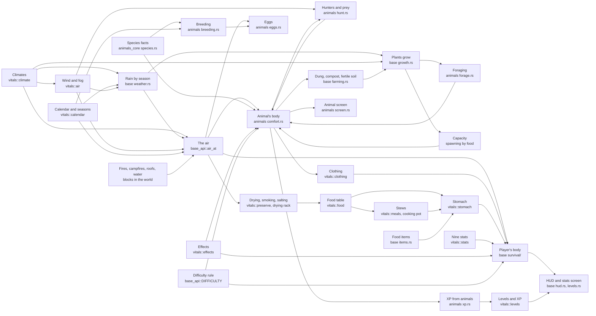

# How the game's systems connect

Read this before changing anything in survival, animals, the world's climate or the HUD. The
whole project (engine, accounts, linked worlds, game) piece by piece is `notes/OVERVIEW.md`. Each
system says where its code and numbers live, what it reads, and what reads it; then what to check
when something changes. The numbers themselves: `mods/base/vitals/SHEET.md` (survival) and
`mods/animals/SPECIES.md` (species), both written from the code. Why things are as they are:
`notes/SURVIVAL.md`, `notes/ANIMALS.md`, `notes/STYLE.md`.

## The map

### Planned: the living world

The loop that closes this map, designed in `notes/ECOLOGY.md`; rain by season, soil water,
plants by the place, food kinds, plant eaters' foraging, capacity, hunting, dung, compost and fertile soil are built: the loop is closed (the rows below). Rain by season
comes from the climate table and falls through the air. It wets the soil, and plants grow by the
place. Grazers eat the plants and hunters eat the grazers, all through one forage goal and food
categories. A place's food sets how many animals it holds. What dies and rots becomes compost,
and compost makes farmland fertile. Every part reads the same few shared things:
- the place (`air_at` grown into `place_at`);
- the climate table;
- a plant table;
- food categories;
- the forage goal.

Their numbers come from real places, plants and animals through one pacing. As each part is
built, it gets its row below and its arrows above.

## The systems

| System | Code | Numbers | Reads | Read by |
|---|---|---|---|---|
| Climates | `vitals::climate::BIOMES`, each from a real place (`reports/ecology/Biome climates.md`) | same | the research | the air, the weather; biomes set it (`base_api::climate` in `worldgen.rs`, `cretaceous.rs`) |
| Food kinds, diets | `vitals::food::Category`, `Species::eats` | `FOODS` rows, species rows | the research | foraging, the sheets, the animal screen's kind |
| Foraging | `vitals::forage::SOURCES`, `mods/animals/src/forage.rs` | `SOURCES` rows | diets, plants (grazed grass grows back), hunger | animals' food and condition |
| Drinking | `animals_core::needs` (`WATER`, `DRINKS`, `drink_lasts`), `mods/animals/src/drink.rs` | `WATER`, `SPARE`, `DAY_SECS`, `THIRSTY`, `SLAKED`, `GULP`, `PARCHED_SECS`, `DRINKS` rows | masses (genes, growth), cold blood, comfort (faster out of it), rain on it, water blocks near | `Animal::thirst`, condition (`comfort::condition`: parched is as weak as starving), wild ones dying of thirst, its screen's water |
| Food off the ground | `vitals::forage::{DROPPED, dropped}`, `forage.rs` (`ground_food`), `World::dropped_item` | food items' kinds and portions (`FOODS`), `DROPPED`, `needs::MEAL` | dropped items, diets, freshness (spoiled is carrion), masses | animals' food; hunters eat it before hunting; items taken off the ground |
| Hunting | `Species::{prey, hungry_in_the_wild}`, `OTHER_PREY`, `mods/animals/src/hunt.rs` | `prey` per species row | diets, masses (genes, growth), families, hunger | wild hunters' food, prey running (`wary`), kills (`ENTITY_DIED`) |
| Birds' flight | `mods/animals/src/birds.rs` (`Wings` per model: raven, small birds, owls, eagles, vulture, gull) | `Wings` rows | walkers (scared), hunters (`hunt::wary`), now and then | the flying look (`<model>_fly`), where a bird lands to forage and hunt again |
| Hunters' hunger | `animals_core::needs` (`MEAL`, `fills`, `prey_in`), `hunt::prey_lush`, `animal::arrive` | `MEAL`, `ARRIVES_FED`, `STARVES_SECS` | prey at home, their food this season (`forage::season_lush`), masses | how fed a wild hunter arrives, what a kill fills (by the prey's mass against its own) |
| Soil, compost | `vitals::soil`, `mods/base/src/farming.rs` | `MAX`, `FEEDS`, `COMPOSTS`, `COMPOST_DAYS` | crops' harvests, dung (grazers), spoiled food (freshness), plant waste | crops' growth on farmland (`growth.rs`), tilling with hoes |
| Food webs | `animals_core::web` (`gaps`, `WAITING`, `grazing`), `core/tests/places.rs` | `WAITING` rows (the gaps the plan fills), `vitals::forage::GRASS_COVER` | species' diets, prey sizes, habitats, crowds and hunger, `vitals::forage::SOURCES`, the grazed grass's growth, climates | the species sheet's food web table, the check |
| Capacity | `vitals::forage::season_lushness`, `forage.rs` (`NATURAL_SPAWN`), `animal::arrive` | `SPAWN_FLOOR`, `ARRIVES_FED`, `YOUNG_PERCENT`, `STARVES_SECS` | plants, climates, calendar, breeding seasons | natural spawning, how fed wild ones arrive, young in season, starving |
| Plants, soil water | `vitals::plants` (`PLANTS`, `rate`, `soil_water`), `base_api::ground_at`, `base_api::grow` (the step any mod's plant takes), `base_api::trees`, `mods/base/src/growth.rs` | `PLANTS` rows, `GROWING` | climates, rain schedule, calendar, height, water within 4 blocks | the growing blocks' steps (wheat, berry bush, sapling, sugar cane, cactus, the wild plants) |
| Wild plants | `vitals::wild` (`WILD`, `pick`), `mods/base/src/wild.rs`, `worldgen.rs` (`wild_at`), `cretaceous.rs` | `WILD` rows (form, ground, gives, found, cover), `MOST`, `REACH`, `CROWD` | plants (their growth and frost), the biomes | the world's decoration, foraging (`SOURCES` rows found where they grow), foods (`FOODS`, `DROPPED`), capacity |
| Trees and the ground's look | `base_api::trees` (crowns, forms), `mods/base/src/worldgen.rs` (`stand`, the stand scatter, the meadow noise), `vitals::wild::FLOWERS` | `trees`, `stand_trees`, `tree_kinds` per biome; `STAND`, `CLEARING`, `FLOWER_MEADOW`; `land::WALL_RISE`, `WALL_REACH` (no trees or shrubs at a wall's foot) | the biomes, `GRASS_COVER` (kept on average) | the world's decoration, browse found where trees grow |
| Giant trees | `base_api::tree_recipes` (`SEQUOIA`, `YOUNG`, `sapling_of`), `base_api::trees::giant_tree_blocks`, `worldgen.rs` (the giant scatter) | `giant_trees`, `giant_kinds` per biome; the recipes' sizes; the engine's `SCATTER_UP` (96) | the biomes (the grove), plants (the sapling's warmth and water) | the world's decoration, distant terrain (their own scatter keeps their height) |
| The land's shape | `base_api::land` (features, `land_height`, `rivers` on the drainage network in `land/net.rs`, `mesa`, `snowy`, `rock_kind`), `mods/base/src/land.rs` (the overworld's terrain and rules, `rock_faces`), the map preview `cargo run -p base_api --example land_map` | where each biome stands in the climate fields (`SNOWY_BELOW`, `TAIGA_BELOW`, `DESERT`, `SAVANNA`, `SWAMP`, `FOREST_HUMIDITY`, `BIRCH`; the biomes in `worldgen.rs` take them, `biome_shares` checks each turns up), `CONTINENTS`, `CONTINENT_SCALE` (the overworld's land masses, 1800 blocks; read the climate through `land::fields(seed)`, never a bare `Fields`), `HILLS` (calmed by the coast: `COAST_CALM`, `HILLS_INLAND`), the coasts (`COAST_CLIFF*`, `OCEAN_DEEP*`, `ISLAND*`), karst towers (`KARST_*`), badland canyons (`CANYON_*`), `HIGHLANDS`, `DUNES`, `MOUNTAINS`, `MESA_*`, `RIVER_*` (the network: `RIVER_NODE`, `RIVER_REACH`, `RIVER_RAIN`, `RIVER_FLOW`; lakes where rivers end, `RIVER_SINK_*`), `OCEAN_CONTINENT`, `RIVER_BEDS`, `SNOW_LINES`, `SNOW_DRIFT`, `ROCK_*`, `GRANITE_ABOVE`, `STRATA` (which stone a face shows, `rock_set`), the faces' ores (`face_ore`, `FACE_COAL`, `FACE_IRONSTONE`, `FACE_MAGNETITE`, `FACE_GOLD`: the early iron and coal a player finds on walls; check against crafting's early needs, some 15-20 iron), `LAKE_*` (lakes in basins, `lakes`, `lake_site`); for planting: `bank` (a river's or lake's bank, how wet, `RIVER_BANK`, `LAKE_BANK`) and `biome_edge` (the nearest other biome and how near, `EDGE_BAND`); borders fray, the neighbour's ground in patches over the band (`fray`, `surface_of`, `FRAY_SHARE`, `FRAY_SIZE`: keep `surface_of` in step with the biomes' `surface` in `worldgen.rs`) | the climate fields (temperature, humidity, continent) | where each biome stands (rivers and lakes inland are the land's biome, so its climate: the air, rain and fog in a river are its banks'), the surface (snow above the line is the mountains biome's), the plants (none on bare rock), trees and boulders standing on it |
| Giant sequoia groves | `base:sequoia_grove`: `vitals::climate` (Giant Forest, 1,721 m), `base_api::land` (`SEQUOIA_AREA`, `SEQUOIA_GROVE`, `SEQUOIA_TEMPERATURE`, `SEQUOIA_HUMIDITY`, `SEQUOIA_RISE`), `land.rs` (its rule), `worldgen.rs` (the biome), `vitals::forage` (its food), `reports/sequoia-grove/README.md` | those | the climate fields and the mountains' area noise (on their front slopes) | the air (its climate), weather (winter snow, dry summers), foraging, trees (`TREE_KINDS`, the sequoia to come), the food web (habitats needed, `animals_core::web`) |
| Vegetation layers | `vitals::layers` (`LAYERS`, `shrub_height`), `base_api::trees` (`young_tree_blocks`, the snag form), `mods/base/src/worldgen.rs` (`FLOOR`, `FLOOR_COVER`, `FERNS`, `SHRUBS`, `SHRUB_KINDS`, `YOUNG_TREES`, `YOUNG_KINDS`, `FERN_KINDS`, `MUSHROOMS`, `MUSHROOM_COVER`, `TALL_GRASS_SHARE`, the shrub and young-tree scatters, the fallen giant, `under_crown`, `beside_log`) | `LAYERS` rows (floor blocks and cover, ferns, shrubs and their leaves) | the biomes, the trees (crowns thicken the floor, trunks the ferns), the grass and flowers (ferns take only the bare soil) | the world's decoration; shrubs are leaves, so browse and leaf drops |
| Rain by season | `mods/base/src/weather.rs`, `vitals::climate::{spell, rains, thunders}` | `rain` per season in `BIOMES` | climates, calendar, the world's seed | the engine (`set_rain`: rain drawn only where it falls), the air (`raining_at`) |
| Wind and fog, snow, storms | `vitals::air`, `mods/base/src/weather.rs` (`/air`) | `wind`, `fog`, `fog_kind` per biome in `BIOMES`; `DAY_SPREAD`, `DAY_SWING`, `STORM`, `CLEARS`, `SNOWS_BELOW`, `SNOWFALL`, `MELT`, `BLIZZARD`, `DRY`, `DUST`, `FOG_SIGHT` | climates, calendar, rain spells and thunder, the world's seed | the engine (`set_air`: snow drawn where it is cold, `scene.weather`/`ground` for the pack's fog, storms, snow lying, swaying plants), the air (`air_at`: wind chill, fog), hunters and prey (`base_api::sight`) |
| Weather sound | `vitals::weather_sound`, `mods/base/src/weather_sound.rs`, the engine's sound handles (`audio.rs`) | `SOUND_SPEED`, `STRIKE`, `CRACK_WITHIN`, `ROOF_UP`, `SAMPLE_RINGS`, `THROUGH_WALLS`, `WIND_HEARD`, `levels`, `muffle`, `thunder_*` | the weather as the engine draws it (`ClientState::rain`, `thunder`, `wind`, `snowing`, `lightnings`: rain by season, wind and storms by biome), the sky light and blocks around the head (open sky, a roof, leaves overhead) | what the player hears: rain, roof and wind beds, thunder after each flash (`weather sound:` and `thunder:` log lines) |
| Block sounds | `mods/base/src/sounds.rs` (`GROUPS`), `assets/sounds/groups.txt` (which block sounds like what), `.sound_group` where blocks are made | the groups' files and pitches | | breaking, placing, steps and mining knocks (engine); `block sounds:` in the log names blocks with none |
| Creature voices | `animals_core::voices` (`FAMILIES`, `VOICES`), `mods/animals/src/voices.rs`, `mods/base/src/mobs.rs` (`.sound`) | a family's files, volume and range; a species' pitch | species (a new one needs a `VOICES` row or the check fails) | hurt, death and idle calls (engine), herds capped per species (`AT_ONCE`); `sound files:` in the log names events missing files |
| Calendar, seasons | `vitals::calendar` | `SEASON_DAYS`, `MIDSUMMER` | engine day time | the air, breeding seasons, day length (`.seasons(..)` on dimensions), the HUD clock |
| Grass and leaves by the year | `vitals::foliage` (`strength`, `tint`; `rain_strength`, `rain_tint`), `mods/base/src/seasons.rs` | `FRESH`, `AUTUMN_*`, `WINTER` (leaves a dead grey-brown), `RAINY_GRASS`, `DRY_GRASS`, `RAIN_AMOUNT` | climates (`seasons` swing in warmth, `rain` by season), calendar, the biomes' base tints | grass and leaf tints through the year: by warmth where the year turns (Kassel), by rain where it doesn't (the llanos, the Pantanal) |
| The air | `base_api::air_at`, `vitals::temperature::air` | `temperature.rs`, `air::feels` | climate, season, hour, height, sky light, rain here (`raining_at`), the wind (`World::air_at`, chilling the cold in the open), water, fires (`base_api::heat_of`) | player's body, animals' bodies, eggs |
| Player's body | `mods/base/src/survival/` (a file per part: breath, food, temperature, camp, stamina, body, load, health) | `vitals` | air, stomach, stats, effects, armor, clothes, difficulty | HUD, health and speed modifiers, death |
| Stomach, food | `vitals::food`, `vitals::stomach`, `base_api::eat` | `FOODS` | food items (`NUTRITION`, `FRESHNESS`) | max health and stamina, regen, warmth, food poisoning |
| Meals | `vitals::meals`, `base_api::eat_meal`, `mods/base/src/cooking.rs` (the cooking pot) | `BONUS`, `MIN`, `MAX`, `COOK_TICKS` | the foods that go in (`FOODS`), fuel | the stomach (a portion an ingredient), well fed, warmth, freshness by the shortest-keeping ingredient |
| Preserving | `vitals::preserve`, `cooking.rs` (drying rack, salt) | `DRY_SECS`, `SMOKE_SECS`, `SMOKE_REACH`, `SMOKE_HEAT`, `SALT_TICKS`, `dry_rate`, `PRODUCTS`; the preserved foods' `FOODS` rows | the still air at the rack (`air_at`: warmth, humidity, wind, rain), fires below (a campfire, a lit furnace, lava), raw meat and fish, fruit | food that keeps for weeks, lighter to carry |
| Food's age through cooking | `survival/food.rs` (`life_used`, `made_for`, `crafted`) | the foods' and meals' keeps | the stamps of what goes in | the pot, the rack and the crafting grid: spoiled refused, stale carried |
| Arrival | `vitals::clothing::ARRIVAL`, `vitals::stomach::ARRIVAL`, `vitals::calendar::START_DAY`, `clothing.rs`, `survival/mod.rs` | those | first joining, a new world | a new player's clothes and stomach, the world's first day |
| Respawning, the way back | `survival/mod.rs` (death), `clothing.rs` (`dress`), `levels.rs` (`tombstone`, `base_api::GRAVE`), `death.rs` (the death screen, the grave marker, the grace) | `stomach::ARRIVAL`, `clothing::ARRIVAL`, `difficulty::{GRACE_SECS, GRAVE_REACHED}` | dying (cause, killer), the tombstone, the player's place | the stomach and stamina after death, plain clothes when none are worn, the death screen, the marker over the hotbar, monsters (`mobs.rs` targets) and creatures' damage (`HURT` veto) held off |
| Hints | `mods/base/src/hints.rs` | `HINTS`, `LOGS_AFTER`, `WET_BELOW`, the client's `SHOW_SECS` | effects, the stomach, the felt air, the hour, the inventory, placed fires, the grave | a line under the crosshair; the player's `base:hints` setting; other mods' hints through `base_api::hint(w, player, key, args)` |
| Advancements | `mods/base/src/advancements.rs` | `ALL`, `GROUPS` | events, inventory, effects, crafting (`crafted`), hot meals, `base_api::MILESTONES` (other mods) | the toast, the screen, XP |
| Crafts that wait | `vitals::crafts`, `mods/base/src/crafts.rs` (tanning frame, tanning pit, charcoal clamp) | `CRAFTS` (real days), `Station::holds`, `plants::GROWING` | hides (animals' and cows' drops), oak bark, logs | buckskin leather (clothes), sole leather (leather armor), coal |
| Rooms | `vitals::shelter`, `survival/shelter.rs` (the flood fill), `survival/temperature.rs` (`ROOM`, the HUD line) | `Wall::{fire_gain, swing}`, `EMPTY_ROOM`, `ROOM_MAX`, `ROOM_FULL`, `BIG_ROOM_SHARE` | the blocks around the player, the day's mean (`Air::mean`), fires | the air the body feels, the HUD |
| Clothing | `vitals::clothing`, `mods/base/src/clothing.rs`, `survival/temperature.rs` (`worn`) | `MATERIALS` (with `makes`), `CLOAKS`, `CLOAK_COVERS`, `PER_CLO`, `STRING`, `FIBRE_PER_STRING`, `FIBRE_CHANCE`, `armor_cloth`; `temperature::{PIECE_SHARE, ARMOR_WET_KEEPS, WET_CHILL}` | pelts (`animals_core::hides`), leather (leather armor is hide), wool, plant fibre | body temperature: the comfort range, what's kept wet, the wind chill felt (`through_clothes`) |
| Crafting book | `mods/base/src/book.rs` (design: `notes/CRAFTING.md`) | `CHEST_REACH` (7, comfort's reach), `TABLE_REACH`, `MAX_BATCH` | every mod's `base:crafting` recipes, the bag, chests within 7 blocks of the crafting table | XP for crafting (`levels::xp::craft`), the bag and the chests it takes from |
| Effects | `vitals::effects` | `modifiers()` | | player's body, animals (cold, heat), HUD icons (`install.py` `EFFECT_ICONS`) |
| Body effects | `base_api::{poison, bleed, sedate}`, `survival/body.rs` | `survival/body.rs` constants | animals' venom (`breath.rs`), darts (`knockout.rs`), spider eye, heavy blows | player's body |
| Carried weight | `survival/load.rs` | `weight` there | inventory | effects (encumbered), stats screen |
| Levels, XP | `vitals::levels`, `mods/base/src/levels.rs` | `levels.rs` | blocks, crafting, kills, advancements, taming (`animals xp.rs`), discoveries | stats screen, HUD |
| Species facts | `animals_core::species`, `biology` | `species.rs` rows | | animals' bodies (comfort), breeding (seasons), habitats (spawning), the species sheet |
| Animal's body | `mods/animals/src/comfort.rs` | `comfort.rs` constants | air, species comfort, food, difficulty | animal stats (condition, speed), comfort-seeking goal, tames' health and hunger, its screen |
| Eggs | `mods/animals/src/eggs.rs` | `animals_core::life::EGG_AIR` | air, nests | hatching |
| Breeding | `mods/animals/src/breeding.rs` | `biology.rs` `breeds`, `peak` | calendar, bond, food | eggs, births, XP |
| Difficulty | `base_api::DIFFICULTY` (a world rule) | `vitals::difficulty` | Create New World, `/rule difficulty` | player's body, eating, tames |
| Entity ranges (engine) | `server/sync.rs` (`move_every`), `server/dim.rs` (`mark_resting`) | world rules `core:entity_send_distance` 96, `core:entity_activation_distance` 48, `core:inactive_entity_interval` 20 | players' positions | what each player is sent and how often; animals' and mobs' goals and paths far from players (once a second), `World::tick_elapsed` |
| Damage causes | `abi::damage` | | | engine death messages (`server/mod.rs`, engine lang en, ru, fr) |
| HUD | `mods/base/src/hud.rs`, `player.rs` | `hud_element` orders 0-8 | vitals, clock | |
| UI art | `mods/base/source/ui/install.py` | the kit | generated sheets (`game-art` skill) | `mods/base/assets/textures/gui` |
| Item models | `mods/base/source/items/` | | icons (`blocky-model` skill) | hand and ground drawing |

## When you change something, check

- **A biome's climate, or a new biome**: its real place first (`reports/ecology/biome_climates.json`,
  `vitals/tests/places.rs` holds the table to it), then its row in `vitals::climate::BIOMES`
  with rain per season, set on the biome with `base_api::climate("<name>")` (a name with no row
  panics at start; a biome that sets none is a mild temperate place raining a quarter of the
  days); the species living there (comfort, eggs: `places.rs` checks); the sheet.
- **A species, or a new one**: its row in `species.rs` with comfort, breeding seasons and
  habitats (each habitat needs a climate); how much of its water it drinks (`needs::DRINKS`; not
  listed, all of it); the species sheet; `places.rs` checks it on its own.
- **A food, or a new food item**: a row in `vitals::food::FOODS`, the one list. A `base:` row is
  the item (`items.rs` makes it from the table: nutrition, freshness, hunger from its size, and
  a raw meat with a `cooked_` row tagged `raw_meat/<name>` and `cooked_meat/<name>`, so it
  smelts, salts, dries and goes in stews). Another mod's food registers its own item (an item
  without a row can't be eaten; the game test `every_food_has_nutrition` fails). Then its lang
  (en, ru) and icon; `balance.rs` (well fed from a few foods); the sheet. Its kind and portion
  are what animals eat it off the ground by (`forage.rs`); an item animals eat that isn't a
  player's food goes in `vitals::forage::DROPPED`.
- **Clothes, or a new material** (`vitals::clothing::MATERIALS`): its clo, heat, wet and wind from
  the research; the items come from the table (`clothing.rs`), with lang (base en, ru) and art;
  `balance.rs`'s clothing checks; the sheet. A new furred species: its row in
  `animals_core::hides`. A species people eat: its row in `animals_core::meat` (and a new
  meat's raw and cooked `FOODS` rows, lang and icons).
- **A meal, or a new preserved food**: the stew is its ingredients (`vitals::meals`), so a new food
  goes in it as it is; a new preserved food is a `FOODS` row, its `preserve::product` line and an
  item in `cooking.rs`'s `PRODUCTS` and `items.rs`'s food list; the sheet.
- **Temperature rules** (`temperature.rs`, `air_at`): players' effects, animals' comfort and
  eggs all move together; `places.rs` says if a species stops being at home or its eggs stop
  hatching.
- **A growing plant, or a new one**: its row in `vitals::plants::PLANTS` from the research
  (`reports/ecology/plants.json`), its block's `.growth(growth::step_secs(..))` and
  `.on_grow(|e| growth::grow(..))` (`blocks.rs`); the sheet.
- **A tree**: its wood in `WOODS` (`blocks.rs`, or `cretaceous.rs` for the Cretaceous's) with its
  shape and fruit, its biomes' `tree_kinds`, its sapling's row in `vitals::plants::PLANTS`, its
  leaves and fruit in `vitals::forage` (`SOURCES` found where it grows, `DROPPED`), textures and
  names.
- **A wild plant**: its row in `vitals::wild::WILD` (form, ground, what it gives, where, how
  thick), its growth in `PLANTS` (not for one that stands), its `SOURCES` rows found where it
  grows, its fruit in `FOODS` or `DROPPED`, a texture and a name. The base mod registers and
  places every row; `wild.rs`'s check says if it can't grow where it's put or crowds the grass.
- **A food in the world, or a new diet**: its row in `vitals::forage::SOURCES` (and the plant that
  renews it in `vitals::plants`), the species' `eats` from its research; `places.rs` checks
  plant eaters find food at home, and `web.rs` that every food in a diet is in the world and
  every plant eater eats in every season; the sheets.
- **A species, or a habitat**: the food webs (`animals_core::web`): its foods, prey and
  predators where it lives. A gap it closes comes off `web::WAITING`; a gap it opens goes on
  with what fills it, or gets filled.
- **The calendar** (season length, midsummer): breeding seasons, day length, the clock, the
  climates' seasons, eggs in each breeding season.
- **An effect, or a new one**: `effects.rs` (`ALL`, `modifiers`, `icon`); its icon in
  `install.py`; HUD; lang (base en, ru); the sheet.
- **A damage cause**: `abi::damage`, the engine's `death_message`, and the engine lang (en, ru,
  fr).
- **The stats** (names, order, a new one): both the player's (`vitals::stats::NAMES`) and the
  animals' (`STAT_NAMES`) must match (`places.rs` checks); both screens; the sheets.
- **Difficulty numbers**: `vitals::difficulty`; the sheet.
- **Anything an animal or mob counts down per tick** (a fuse, a timer, growing up): far from
  players its kind ticks only once a second, so count down by `w.tick_elapsed(id)`, or keep a
  due time. Projectiles and what must run every tick are `.always_active()`.

## Adding a new piece

1. Add its row to the table above: what it reads, what reads it.
2. Put its numbers in the shared crates (`mods/base/vitals`, `mods/animals/core`), not loose in a
   mod's code, so checks and sheets can read them.
3. Add a check that ties it to what it touches (`mods/animals/core/tests/places.rs`,
   `mods/base/vitals/src/balance.rs`, or a game test in `mods/testkit`).
4. Regenerate the sheets:
   - `cargo run -p vitals --bin sheet > mods/base/vitals/SHEET.md`
   - `mods/animals/web/build.sh && node mods/animals/web/sheet.mjs`

## The checks

| Check | Where | Catches |
|---|---|---|
| The climates are their real places | `vitals/tests/places.rs` | a biome's year mean, seasons or rainiest season drifting from its place's research |
| The year's colors read right | `vitals/src/foliage.rs` | summer off the biome's own color, the tropics' warmth not turning them, autumn leaves not warm, winter leaves greener or brighter than autumn's, the llanos not green in the rains and straw in the dry season, a jump at the year's end |
| Every plant grows somewhere | `vitals/tests/places.rs` | a plant whose warmth or water no biome gives |
| Wild plants grow where they're put | `vitals/src/wild.rs` | a wild plant under a third of its best in every season of a biome it's found in, a gift that is no food, covers crowding out the grass |
| Vegetation layers leave room | `vitals/src/layers.rs` | floor patches over half the soil under crowns, ferns over half the bare soil round trunks, shrubs with no kinds, a biome with no climate |
| Plant eaters find food where they live | `animals/core/tests/places.rs` | a plant eater whose food grows in fewer than two seasons in one of its habitats |
| Hunters fill up on their prey at home | same | a hunter whose biggest prey at home takes more than ten kills to fill it |
| Most of every diet is in the game | same | a species with under half its diet growing or on the ground as items |
| A drink lasts a while | same | a species that would be thirsty again in under 10 minutes |
| Desert animals barely drink | same | a species living only in dry places that drinks over half its water |
| One growing pace | `animals/core/tests/places.rs` | `vitals::plants::GROWING` and `animals_core::biology::GROWING` apart |
| Rain follows the shares | `vitals/src/climate.rs` | the rain schedule raining more or less often than a season's share |
| Every habitat has a climate | `animals/core/tests/places.rs` | a species living in a biome with no climate |
| Each species is at home in its habitats | same | comfort ranges that don't fit the climates (cold or hot a quarter of the year at home, half elsewhere) |
| Eggs hatch where and when they're laid | same | eggs that can't develop in a nest in a habitat in the breeding season |
| The stats are the same nine | same | players' and animals' stats out of step |
| Every food has nutrition | `testkit` `every_food_has_nutrition` | food items that can't be eaten |
| Clothes warm, the pot cooks | `testkit` `clothes_and_stew` | the clothing slots not read by body temperature (`/warmth`), the cooking pot not making a stew |
| The calendar follows the day | `testkit` `calendar_follows_time` | the date (HUD, seasonal tints) not following a time jump, also in creative |
| Survival balance | `vitals/src/balance.rs` | foods, stomach, levels and calendar out of balance; clothes that don't warm, cool or keep out the wind as their material should; a stew of three foods not making one well fed; preserved food keeping too little; a rack drying in the damp cold or not in a desert summer |
| Every hide is a species | `animals/core/src/hides.rs` | a pelt or hide row for a species that isn't there |
| Every meat is a species and a food | `animals/core/src/meat.rs` | a meat row for a species that isn't there, or a meat with no raw or cooked `FOODS` row |
| Species balance | `animals/core/src/balance.rs` | species numbers against their facts |
| The sheets are up to date | `vitals/tests/sheet.rs`, `animals/core/tests/sheet.rs` | a sheet not regenerated after a change |
