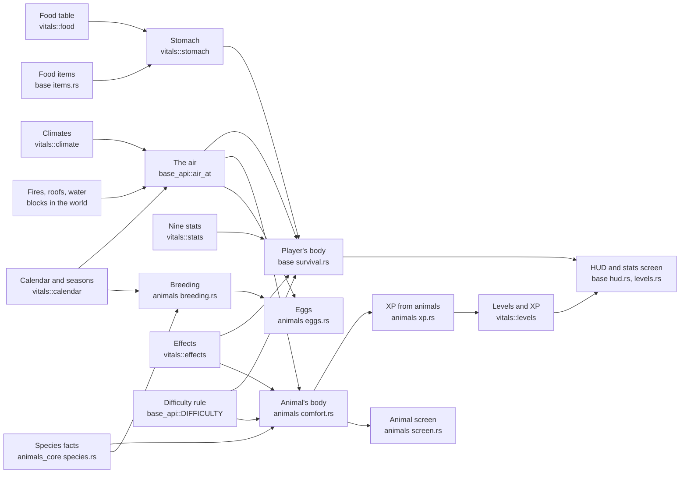

# How the game's systems connect

Read this before changing anything in survival, animals, the world's climate or the HUD. The
whole project (engine, accounts, linked worlds, game) piece by piece is `notes/OVERVIEW.md`. Each
system says where its code and numbers live, what it reads, and what reads it; then what to check
when something changes. The numbers themselves: `mods/base/vitals/SHEET.md` (survival) and
`mods/animals/SPECIES.md` (species), both written from the code. Why things are as they are:
`notes/SURVIVAL.md`, `notes/ANIMALS.md`, `notes/STYLE.md`.

## The map

## The systems

| System | Code | Numbers | Reads | Read by |
|---|---|---|---|---|
| Climates | `vitals::climate::BIOMES` | same | | the air; biomes set it (`base_api::climate` in `worldgen.rs`, `cretaceous.rs`) |
| Calendar, seasons | `vitals::calendar` | `SEASON_DAYS`, `MIDSUMMER` | engine day time | the air, breeding seasons, day length (`.seasons(..)` on dimensions), the HUD clock |
| The air | `base_api::air_at`, `vitals::temperature::air` | `temperature.rs` | climate, season, hour, height, sky light, rain, water, fires (`base_api::heat_of`) | player's body, animals' bodies, eggs |
| Player's body | `mods/base/src/survival.rs` | `vitals` | air, stomach, stats, effects, armor, difficulty | HUD, health and speed modifiers, death |
| Stomach, food | `vitals::food`, `vitals::stomach`, `base_api::eat` | `FOODS` | food items (`NUTRITION`, `FRESHNESS`) | max health and stamina, regen, warmth, food poisoning |
| Effects | `vitals::effects` | `modifiers()` | | player's body, animals (cold, heat), HUD icons (`install.py` `EFFECT_ICONS`) |
| Body effects | `base_api::{poison, bleed, sedate}` | `survival.rs` constants | animals' venom (`breath.rs`), darts (`knockout.rs`), spider eye, heavy blows | player's body |
| Carried weight | `survival::weight` | same | inventory | effects (encumbered), stats screen |
| Levels, XP | `vitals::levels`, `mods/base/src/levels.rs` | `levels.rs` | blocks, crafting, kills, advancements, taming (`animals xp.rs`), discoveries | stats screen, HUD |
| Species facts | `animals_core::species`, `biology` | `species.rs` rows | | animals' bodies (comfort), breeding (seasons), habitats (spawning), the species sheet |
| Animal's body | `mods/animals/src/comfort.rs` | `comfort.rs` constants | air, species comfort, food, difficulty | animal stats (condition, speed), comfort-seeking goal, tames' health and hunger, its screen |
| Eggs | `mods/animals/src/eggs.rs` | `animals_core::life::EGG_AIR` | air, nests | hatching |
| Breeding | `mods/animals/src/breeding.rs` | `biology.rs` `breeds`, `peak` | calendar, bond, food | eggs, births, XP |
| Difficulty | `base_api::DIFFICULTY` (a world rule) | `vitals::difficulty` | Create New World, `/rule difficulty` | player's body, eating, tames |
| Damage causes | `abi::damage` | | | engine death messages (`server/mod.rs`, engine lang en, ru, fr) |
| HUD | `mods/base/src/hud.rs`, `player.rs` | `hud_element` orders 0-8 | vitals, clock | |
| UI art | `mods/base/source/ui/install.py` | the kit | generated sheets (`game-art` skill) | `mods/base/assets/textures/gui` |
| Item models | `mods/base/source/items/` | | icons (`blocky-model` skill) | hand and ground drawing |

## When you change something, check

- **A biome's climate, or a new biome**: its row in `vitals::climate::BIOMES`, set on the biome
  with `base_api::climate("<name>")` (a name with no row panics at start; a biome that sets none
  is a mild temperate place); the species living there (comfort, eggs: `places.rs` checks); the
  sheet.
- **A species, or a new one**: its row in `species.rs` with comfort, breeding seasons and
  habitats (each habitat needs a climate); the species sheet; `places.rs` checks it on its own.
- **A food, or a new food item**: a row in `vitals::food::FOODS` (an item without one can't be
  eaten; the game test `every_food_has_nutrition` fails); `NUTRITION` and `FRESHNESS` on the
  item (`items.rs`); `balance.rs` (well fed from a few foods); the sheet.
- **Temperature rules** (`temperature.rs`, `air_at`): players' effects, animals' comfort and
  eggs all move together; `places.rs` says if a species stops being at home or its eggs stop
  hatching.
- **The calendar** (season length, midsummer): breeding seasons, day length, the clock, the
  climates' seasons, eggs in each breeding season.
- **An effect, or a new one**: `effects.rs` (`ALL`, `modifiers`, `icon`); its icon in
  `install.py`; HUD; lang (base en, ru); the sheet.
- **A damage cause**: `abi::damage`, the engine's `death_message`, and the engine lang (en, ru,
  fr).
- **The stats** (names, order, a new one): both the player's (`vitals::stats::NAMES`) and the
  animals' (`STAT_NAMES`) must match (`places.rs` checks); both screens; the sheets.
- **Difficulty numbers**: `vitals::difficulty`; the sheet.

## Adding a new piece

1. Add its row to the table above: what it reads, what reads it.
2. Put its numbers in the shared crates (`mods/base/vitals`, `mods/animals/core`), not loose in a
   mod's code, so checks and sheets can read them.
3. Add a check that ties it to what it touches (`mods/animals/core/tests/places.rs`,
   `mods/base/vitals/src/balance.rs`, or a game test in `mods/testkit`).
4. Regenerate the sheets:
   - `cargo run -p vitals --bin sheet > mods/base/vitals/SHEET.md`
   - `mods/animals/web/build.sh && node mods/animals/web/sheet.mjs`

## The checks

| Check | Where | Catches |
|---|---|---|
| Every habitat has a climate | `animals/core/tests/places.rs` | a species living in a biome with no climate |
| Each species is at home in its habitats | same | comfort ranges that don't fit the climates (cold or hot a quarter of the year at home, half elsewhere) |
| Eggs hatch where and when they're laid | same | eggs that can't develop in a nest in a habitat in the breeding season |
| The stats are the same nine | same | players' and animals' stats out of step |
| Every food has nutrition | `testkit` `every_food_has_nutrition` | food items that can't be eaten |
| Survival balance | `vitals/src/balance.rs` | foods, stomach, levels and calendar out of balance |
| Species balance | `animals/core/src/balance.rs` | species numbers against their facts |
| The sheets are up to date | `vitals/tests/sheet.rs`, `animals/core/tests/sheet.rs` | a sheet not regenerated after a change |
