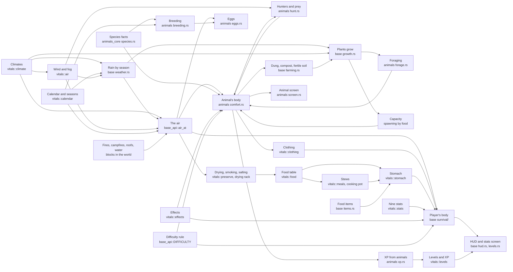

# How the game's systems connect

Read this before changing anything in survival, animals, the world's climate or the HUD. The
whole project (engine, accounts, linked worlds, game) piece by piece is `notes/OVERVIEW.md`. Each
system says where its code and numbers live, what it reads, and what reads it; then what to check
when something changes. The numbers themselves: `mods/base/vitals/SHEET.md` (survival) and
`mods/animals/SPECIES.md` (species), both written from the code. Why things are as they are:
`notes/SURVIVAL.md`, `notes/ANIMALS.md`, `notes/STYLE.md`.

## The map

### Planned: the living world

The loop that closes this map, designed in `notes/ECOLOGY.md`; rain by season, soil water,
plants by the place, food kinds, plant eaters' foraging, capacity, hunting, dung, compost and fertile soil are built: the loop is closed (the rows below). Rain by season
comes from the climate table and falls through the air. It wets the soil, and plants grow by the
place. Grazers eat the plants and hunters eat the grazers, all through one forage goal and food
categories. A place's food sets how many animals it holds. What dies and rots becomes compost,
and compost makes farmland fertile. Every part reads the same few shared things:
- the place (`air_at` grown into `place_at`);
- the climate table;
- a plant table;
- food categories;
- the forage goal.

Their numbers come from real places, plants and animals through one pacing. As each part is
built, it gets its row below and its arrows above.

## The systems

| System | Code | Numbers | Reads | Read by |
|---|---|---|---|---|
| Climates | `vitals::climate::BIOMES`, each from a real place (`reports/ecology/Biome climates.md`) | same | the research | the air, the weather; biomes set it (`base_api::climate` in `worldgen.rs`, `cretaceous.rs`) |
| Food kinds, diets | `vitals::food::Category`, `Species::eats` | `FOODS` rows, species rows | the research | foraging, the sheets, the animal screen's kind |
| Foraging | `vitals::forage::SOURCES`, `mods/animals/src/forage.rs` | `SOURCES` rows | diets, plants (grazed grass grows back), hunger | animals' food and condition |
| Drinking | `animals_core::needs` (`WATER`, `DRINKS`, `drink_lasts`), `mods/animals/src/drink.rs` | `WATER`, `SPARE`, `DAY_SECS`, `THIRSTY`, `SLAKED`, `GULP`, `PARCHED_SECS`, `DRINKS` rows | masses (genes, growth), cold blood, comfort (faster out of it), rain on it, water blocks near, the seconds since it last ticked (`life::seconds_due`: far ones rest) | `Animal::thirst`, condition (`comfort::condition`: parched is as weak as starving), wild ones dying of thirst, its screen's water |
| Food off the ground | `vitals::forage::{DROPPED, dropped}`, `forage.rs` (`ground_food`), `World::dropped_item` | food items' kinds and portions (`FOODS`), `DROPPED`, `needs::MEAL` | dropped items, diets, freshness (spoiled is carrion), masses | animals' food; hunters eat it before hunting; items taken off the ground |
| Hunting | `Species::{prey, hungry_in_the_wild}`, `OTHER_PREY`, `mods/animals/src/hunt.rs` | `prey` per species row | diets, masses (genes, growth), families, hunger | wild hunters' food, prey running (`wary`), kills (`ENTITY_DIED`) |
| Birds' flight | `mods/animals/src/birds.rs` (`Wings` per model: raven, small birds, owls, eagles, vulture, gull) | `Wings` rows | walkers (scared), hunters (`hunt::wary`), now and then | the flying look (`<model>_fly`), where a bird lands to forage and hunt again |
| Hunters' hunger | `animals_core::needs` (`MEAL`, `fills`, `prey_in`), `hunt::prey_lush`, `animal::arrive` | `MEAL`, `ARRIVES_FED`, `STARVES_SECS` | prey at home, their food this season (`forage::season_lush`), masses | how fed a wild hunter arrives, what a kill fills (by the prey's mass against its own) |
| Field journal | `animals_core::journal` (`facts`, `known`, `note`, `deeds`), `mods/animals/src/journal.rs` (`JOURNAL`, `note`, `entries`, `NEW` for the toast, `/journal`), the screen `journal_screen.rs` (UI: its tab, the key I) | `SEEN_WITHIN` (in line of sight: no opaque block between), the deed bits (seen, hunted, tamed or ridden, bred), `Section`s, `ENTRIES`; `Species::active`; checks: `journal.rs`' tests (ids distinct, every species' basics, deeds needed, every key in en and ru) | every species row (mass, habitats, diet, temper, social, taming, foods, seat and flight, seasons, gestation or incubation, litter, growth, lifespan), `meat::MEAT`, `hides::HIDES`; players near animals, kills, `taming::tame`, `breeding::born` (owner), `riding` (mount, counts as tamed), the spyglass and animal screens | the journal screen (UI); a changed species number shows in the journal at once |
| Soil, compost | `vitals::soil`, `mods/base/src/farming.rs` | `MAX`, `FEEDS`, `COMPOSTS`, `COMPOST_DAYS`, `crops::Crop::soil` | crops' ripe harvests (tire it; beans feed it), dung (grazers), spoiled food (freshness), plant waste | crops' growth on farmland (`growth.rs`), tilling with hoes |
| Dung pats | `vitals::soil` (`MOUTHFULS_A_PAT`, `PAT_SPACING`, `PAT_REACH`, `PAT_GROWTH`, `PAT_MOST_DAYS`), `vitals::plants` (`base:dung_pat`'s rot), `blocks.rs` (`DUNG_PAT`, `pat_near`), `mods/animals/src/forage.rs` (`drop_pat`) | the grazers' mouthfuls (`forage.rs`), warmth and soil water where it lies (`ground_at`) | grazed grass's regrowth beside it (x2), a fresh tuft where it rots, the dung item (compost, farmland); the species sheet's grazing column and `animals_core::web`'s "carpeted in dung" check (at most 1% of a herd's ground) |
| Fireflies (`notes/NIGHT_GLOW.md`) | `vitals::fireflies`, `mods/base/src/fireflies.rs` (the server's share per player, `base:fireflies`; the client's spawner; `base:fx_fireflies`, a row in `video.rs`) | `WEIGHTS` per biome, `FLY_MIN_C`, `SEASON_MIN_C`, `COUNTS`, `REACH`, `CLUSTER`, `TORCH_MAX`, `SKY_MIN`, `LIFE_SECS`, `DRIFT`, `REFRESH_SECS`, `hour_share` | the climate table (season's mean air), the air at the player (`air_at`), soil water (`ground_at`), the rain where the player is, the sunset (`calendar::daylight_hours`), the light where one goes | the night's look only (no light, no gameplay); Lighting's particle blink |
| Glowing plants (`notes/NIGHT_GLOW.md`) | `vitals::wild::{GLOW, LIES_FLAT}`, `base:foxfire`, `base:glow_mycena`, `base:goblins_gold` as wild rows (`wild.rs`) | `GLOW` (light 1-4, checked), their `PLANTS` and `WILD` rows | warmth and soil water like the mushrooms (`growth.rs`), the forest floor at worldgen, like the mushrooms | the block light at night (dim pockets in dark forests); the pack's emission scaling and `base:fx_glow` (Lighting) |
| Food webs | `animals_core::web` (`gaps`, `WAITING`, `grazing`), `core/tests/places.rs` | `WAITING` rows (the gaps the plan fills), `vitals::forage::GRASS_COVER` | species' diets, prey sizes, habitats, crowds and hunger, `vitals::forage::SOURCES`, the grazed grass's growth, climates | the species sheet's food web table, the check |
| Hitboxes | `animals_core::bodies` (`BOXES` by model, `LOOSE`), every kind's `.size` and the puppy's `set_size`, `core/tests/boxes.rs` | the boxes | the models (`assets/models/*.geo.json`, at rest) | hitting, clicking (taming, the screen), riding, arrows and darts, what fits through gaps, hunters' reach (`commands::fight`), breath aim |
| Habitats, natural spawning | `Species::{habitats, cretaceous, spawn_chance}`, `mods/animals/src/habitats.rs` (a rule per species and biome, in its own world only: `world`), `fish.rs` (fish's own spawner) | `Rarity::spawn_chance`, each habitat's share, `CRETACEOUS_FLOW` (the Cretaceous's biomes average the overworld's flow), `Social::group` | the biomes (the Cretaceous's beaches and seas are base's), the engine's spawner (a rule picked at random, then its chance; 6 passive within 64 blocks of a player) | capacity (`NATURAL_SPAWN`: food and room), the census and `/animal habitats` |
| Capacity | `vitals::forage::season_lushness`, `forage.rs` (`NATURAL_SPAWN`), `animals_core::life::room_for`, `Species::crowd_in` (`species::crowd_at` in the mod), `animal::arrive` | `SPAWN_FLOOR`, `ARRIVES_FED`, `YOUNG_PERCENT`, `STARVES_SECS`; the room: `Species::crowd`, `life::CROWD_RADIUS`, `STOCKING` (plant eaters' crowd by biome: savanna 2.5 to the sequoia grove 0.09) | plants, climates, calendar, breeding seasons, its kind near the spot (no group comes past its crowd; `/tk spawn` ignores it) | natural spawning, how fed wild ones arrive, young in season, starving |
| Plants, soil water | `vitals::plants` (`PLANTS`, `rate`, `soil_water`), `base_api::ground_at`, `base_api::grow` (the step any mod's plant takes), `base_api::trees`, `mods/base/src/growth.rs` | `PLANTS` rows, `GROWING` | climates, rain schedule, calendar, height, water within 4 blocks | the growing blocks' steps (the crops, berry bush, sapling, sugar cane, cactus, the wild plants) |
| Wild plants | `vitals::wild` (`WILD`, `pick`), `mods/base/src/wild.rs`, `worldgen.rs` (`wild_at`), `cretaceous.rs` | `WILD` rows (form, ground, gives, found, cover), `MOST`, `REACH`, `CROWD` | plants (their growth and frost), the biomes | the world's decoration, foraging (`SOURCES` rows found where they grow), foods (`FOODS`, `DROPPED`), capacity |
| Crops | `vitals::crops` (`CROPS`, `WILD_SEED_CHANCE`, `BREAD_GRAINS`; stems' `fruit`; the tall grains' `tall`), `mods/base/src/crops.rs` (a tall crop's `_top` block stands on it, breaks with it and drops nothing of its own), wheat in `blocks.rs` | `CROPS` rows (seed, harvest, stages, soil, wild biomes), their `PLANTS` rows, their `FOODS` rows | plants (growth, frost, ripening season), farmland's fertility, tall grass and biomes (wild seed) | foods and cooking (baked potato, roasted corn, cooked rice, bread from any grain; pumpkin and melon slices, their seeds), farmland's fertility |
| Trees and the ground's look | `base_api::trees` (crowns, forms), `base_api::branchy` and `tree_recipes` (each species' shape; `understory`, the young grown small from their own recipe; checked on `mods/base/source/trees/audit.py`'s sheets), `mods/base/src/worldgen.rs` (`stand`, the stand scatter, the meadow noise), `vitals::wild::FLOWERS` | `trees`, `stand_trees`, `tree_kinds` per biome; `STAND`, `CLEARING`, `FLOWER_MEADOW`; `land::WALL_RISE`, `WALL_REACH` (no trees or shrubs at a wall's foot) | the biomes, `GRASS_COVER` (kept on average) | the world's decoration, browse found where trees grow; a recipe change moves its log counts, and so felling's axe tiers (`cargo run -p base_api --example tree_logs`) |
| The tropical forest's plants | `base_api::tree_recipes` (`BRAZIL_NUT`, `YOUNG_BRAZIL_NUT`, `ANDIROBA`, `MATAMATA`, `IPE`, cacao), `blocks.rs` (`WOODS`, `LIANA`, `BRAZIL_NUT_BUTTRESS`, `BROMELIAD`, `BANANA`, `PHILODENDRON`, `DEEP_LEAF_LITTER`), `worldgen.rs` (`lianas`, `giant_foot`, `BIG_LEAVES`, treefall gaps: `TREEFALL`, `in_gap`, `gap_growth`), `vitals::wild` (`OWN_COLOURS`, the ipê in `BLOOMS`, heliconia in `FLOWERS`), `vitals::layers` (its row, `lianas`, `PENDING`), its biome's `TREE_KINDS` and `GIANT_KINDS` (`worldgen.rs`; a giant's species stands in a tree's site as its young one) | the recipes' sizes; the row's floor, ferns, shrubs, young kinds and `lianas` (0.4); the saplings' `PLANTS` rows; Brazil nuts, cacao pods, cacao beans (crafted from a pod, roasted in the furnace: `recipes.rs`) and the wild banana's bananas (`vitals::wild::BANANA_FRUIT`, from its lower half) in `FOODS`; nuts and pods in `forage::DROPPED` | the biome (Terrain's, `base:tropical_forest`), its climate (Manaus) | the world's decoration there, foods, the animals' seeds and fruit on the ground |
| Bloom | `vitals::wild` (`BLOOMS`, `blooms`, `in_bloom`), `mods/base/src/blocks.rs` (`bloom`) | `BLOOMS` rows (leaves, seasons), `BLOOM_SECS` | the calendar's season (`ground_at`), the leaves' tints (the tinted ones bloom under a tinted `_bloom_overlay`) | the world's look by season |
| Giant trees | `base_api::tree_recipes` (`SEQUOIA`, `YOUNG`, `sapling_of`), `base_api::trees::giant_tree_blocks`, `worldgen.rs` (the giant scatter) | `giant_trees`, `giant_kinds` per biome; the recipes' sizes; the engine's `SCATTER_UP` (96) | the biomes (the grove), plants (the sapling's warmth and water) | the world's decoration, distant terrain (their own scatter keeps their height) |
| The land's shape | `base_api::land` (features, `land_height`, `rivers` on the drainage network in `land/net.rs`, `mesa`, `snowy`, `rock_kind`), `mods/base/src/land.rs` (the overworld's terrain and rules, `rock_faces`), the map preview `cargo run -p base_api --example land_map` | where each biome stands in the climate fields (`SNOWY_BELOW`, `TAIGA_BELOW`, `DESERT`, `SAVANNA`, `SWAMP`, `TROPICAL` (the tropical forest: the hot, wet corner, low land too, before the swamp; its still water at the sea's level, `tropical_water`, `IGAPO_*`, `IGARAPE_*`), `FOREST_HUMIDITY`, `BIRCH`; the biomes in `worldgen.rs` take them, `biome_shares` checks each turns up), the spawn (`spawn`, `SPAWN_*`: level temperate plains by water and woods), `CONTINENTS`, `CONTINENT_SCALE` (the overworld's land masses, 1800 blocks; read the climate through `land::fields(seed)`, never a bare `Fields`), `HILLS` (calmed by the coast: `COAST_CALM`, `HILLS_INLAND`), the coasts (`COAST_CLIFF*`, `OCEAN_DEEP*`, `ISLAND*`), karst towers (`KARST_*`) and sinkholes (`SINK_*`), meteor craters (`CRATER_*`), warm lagoons and coral reefs (`REEF_*`, `reefs`, `reef_part`: the biomes `lagoon` and `coral_reef` by height 2 / 3-5 under the surface in warm water near the coasts, so any warm shallows at those depths take them), arches and sea-cliff waterfalls (`ARCH_*`, `FALL_*`, `landmarks`: a waterfall is placed as the engine's water settles; if the liquid rules change, rerun the settle look), cave mouths (`MOUTH_*`, `caves`: a copy of the engine's caves at the surface; keep it in step with `crates/engine/src/server/terrain.rs`), badland canyons (`CANYON_*`), `HIGHLANDS`, `DUNES`, `MOUNTAINS` (ranges along a noise's zero lines: `RANGE_SCALE`, `RANGE_WIDTH`, `RANGE_GAPS`; their height by the band squared, `MOUNTAINS_RISE`, so the foothills walk up in steps of one (`foothills_are_walkable`; the biome, rivers and spawn still go by `MOUNTAINS_AREA`); moving them moves every mountain, the sequoia groves on their flanks and the rivers round them, and saves made before get seams where new chunks meet saved ones), glaciers (`glacier`, `GLACIER_*`: base's glacier ice in the high hollows), cirque tarns (`TARN_*`, `tarns`, `tarn_level`: small lakes in the ranges' hollows under the glaciers, their bowls the last feature and their water a decoration, held by a closed ring one over the water; `tarns_hold_their_water`; their streams, `STREAM_MAX`, `STREAM_MIN`, `STREAM_WANDER`, `STREAM_BEND`, `stream_bed`: from the ring's lowest column down, winding (a noise picks among the ways nearly as low) in a channel that never rises and is walled on both sides, still water a block deep, kept only if it ends in a hollow or at the sea; `tarn_streams_stay_in_their_channels`), `MESA_*`, `RIVER_*` (the network: `RIVER_NODE`, `RIVER_REACH`, `RIVER_RAIN`, `RIVER_FLOW`; lakes where rivers end, `RIVER_SINK_*`), `OCEAN_CONTINENT`, `BEACH_CONTINENT` (beaches by the sea only; the low coast past it keeps sand within `SEA_SAND` of the sea, `sea_sand`, its biome the land's), `RIVER_BEDS`, `SNOW_LINES`, `SNOW_DRIFT`, `ROCK_*`, `GRANITE_ABOVE`, `STRATA` (which stone a face shows, `rock_set`), the faces' ores (`face_ore`, `FACE_COAL`, `FACE_IRONSTONE`, `FACE_MAGNETITE`, `FACE_GOLD`: the early iron and coal a player finds on walls; check against crafting's early needs, some 15-20 iron), `LAKE_*` (lakes in basins, `lakes`, `lake_site`); for planting: `bank` (a river's or lake's bank, how wet, `RIVER_BANK`, `LAKE_BANK`) and `biome_edge` (the nearest other biome and how near, `EDGE_BAND`); borders fray, the neighbour's ground in patches over the band (`fray`, `surface_of`, `FRAY_SHARE`, `FRAY_SIZE`: keep `surface_of` in step with the biomes' `surface` in `worldgen.rs`) | the climate fields (temperature, humidity, continent) | where each biome stands (rivers and lakes inland are the land's biome, so its climate: the air, rain and fog in a river are its banks'), the surface (snow above the line is the mountains biome's), the plants (none on bare rock), trees and boulders standing on it |
| Giant sequoia groves | `base:sequoia_grove`: `vitals::climate` (Giant Forest, 1,721 m), `base_api::land` (`SEQUOIA_AREA`, `SEQUOIA_GROVE`, `SEQUOIA_TEMPERATURE`, `SEQUOIA_HUMIDITY`, `SEQUOIA_RISE`), `land.rs` (its rule), `worldgen.rs` (the biome), `vitals::forage` (its food), `reports/sequoia-grove/README.md` | those | the climate fields and the mountains' area noise (on their front slopes) | the air (its climate), weather (winter snow, dry summers), foraging, trees (`TREE_KINDS`, the sequoia to come), the food web (habitats needed, `animals_core::web`) |
| Vegetation layers | `vitals::layers` (`LAYERS`, `shrub_height`), `base_api::trees` (`young_tree_blocks`, the snag form), `mods/base/src/worldgen.rs` (`FLOOR`, `FLOOR_COVER`, `FERNS`, `SHRUBS`, `SHRUB_KINDS`, `YOUNG_TREES`, `YOUNG_KINDS`, `FERN_KINDS`, `MUSHROOMS`, `MUSHROOM_COVER`, `TALL_GRASS_SHARE`, the shrub and young-tree scatters, the fallen giant, `under_crown`, `beside_log`) | `LAYERS` rows (floor blocks and cover, ferns, shrubs and their leaves) | the biomes, the trees (crowns thicken the floor, trunks the ferns), the grass and flowers (ferns take only the bare soil) | the world's decoration; shrubs are leaves, so browse and leaf drops |
| The first day | `vitals::calendar` (`START_DAY`, `START_HOUR`, `day_rate`), `mods/base/src/survival/mod.rs` (`tick`), the engine's `World::set_day_rate` | `START_HOUR` 10:00, `FIRST_DAY_RATE` 0.5 until `FIRST_DAY_UNTIL` 18:00 | the calendar, the air's day swing (`temperature::air`) | a new world's clock: spring's 8th at 10:00, its first day's daylight about 13 real minutes; the sky, the HUD clock and everything that follows the time of day (not what waits on ticks) |
| Felling, leaf decay | `mods/base/src/felling.rs`, `mods/base/src/fall.rs` (the fall: lifted with its crown, leaning by the engine's body pose `World::body_turn`, shedding leaves, striking what is in its way), `mods/base/src/felled.rs` (the tree laid down, its pieces), `mods/base/src/leaf_decay.rs` (`BLOCK_BROKEN`, `BLOCK_PLACED`, `question::BREAK_BLOCK` as mining starts, a world tick), the engine's `World::break_block` and `MINING_SPEED` attribute | `vitals::felling` (chop time logs^0.75 one log's, axe tiers by harvest level, 8x and no wood past the tier; the sheet's Felling table); `MAX_LOGS` 2048, `REACH` 12 (the tropical giants' limbs), `MIN_LEAVES` 4; leaves: `base_api::branchy::LEAF_REACH` 6 (every species' leaves within it: a test), a second to a minute | tools (`tools/axe`, durability, the stack's `TOOL_LEVEL` and `MINING_SPEED` from crafting's parts), the player's mining speed (a `base:felling` modifier while a foot is mined; another mining start or the felling takes it off), logs, leaves and `leaves/tree` tags, leaves' `placed` prop, stamina and levels (each felled log is a block broken), tree sizes (`cargo run -p base_api --example tree_logs`) | no tree is left in the air: one that loses its foot or a trunk log by any means falls (bare hands and other tools slow and fruitless at the foot: the first axe is lashed by hand off the ground, `first.rs`); trees come down whole with an axe from the foot (one trunk, rooted in its own base), or what stands on a cut in the trunk (the logs under it left as a stump; Ronald, 11-04: "Fells what's above"), slower the bigger, and lie on the ground away from the player in pieces of 4 (logs' `felled` prop; the animals' logs carry it too), cut a piece at a time for the wood at the player's feet (none past the axe's tier); a falling tree breaks leaves, plants and branches in its path, fells a trunk with half its logs or fewer (leaving a stump), hangs up on a bigger one (settles there as blocks; chopping it or the holder brings it down) and hurts creatures in its way (2 + logs/10, up to 20); it creaks, rushes and thuds; their crowns fall and drop saplings, sticks, fruit |
| Rain by season | `mods/base/src/weather.rs`, `vitals::climate::{spell, rains, thunders}` | `rain` per season in `BIOMES` | climates, calendar, the world's seed | the engine (`set_rain`: rain drawn only where it falls), the air (`raining_at`) |
| Wind and fog, snow, storms | `vitals::air`, `mods/base/src/weather.rs` (`/air`) | `wind`, `fog`, `fog_kind` per biome in `BIOMES`; `DAY_SPREAD`, `DAY_SWING`, `STORM`, `CLEARS`, `SNOWS_BELOW`, `SNOWFALL`, `MELT`, `BLIZZARD`, `BLIZZARD_FOG`, `DRY`, `DUST`, `FOG_SIGHT`; across borders `AIR_BLEND` (`base_api::around`: 9 looks, the middle twice); in forests `FOREST_CALM`, `CANOPY_SHELTERS`, `FOREST_EDGE`, `EDGE_COVER` (`shelter`, `base_api::cover`) | climates, calendar, rain spells and thunder, the world's seed | the engine (`set_air`: snow drawn where it is cold, `scene.weather`/`ground` for the pack's fog, storms, snow lying, swaying plants), the air (`air_at`: wind chill, fog), hunters and prey (`base_api::sight`) |
| The light under the leaves | `vitals::air::CANOPY` (beside `AURORA`), `mods/base/src/weather.rs` (`sky_flags`), the pack (`look.wgsl` `canopy`, `under_leaves`, `LEAF_LIGHT`; `world.wgsl` `sun_shadow`; `post/volume.wgsl`) | `CANOPY` per biome name (how closed its canopy is, 0..1: the tropical forest 1); the knobs `look_canopy`, `look_shafts` (`look.rs`) | the biome where the player stands (`air_flags::CANOPY_SHIFT` to `scene.canopy`), the sky light under leaves (opacity 1 a layer: the crowns 3-5 deep, Plants), see-through leaf texels (the shadow pass drops them: sunflecks), the morning fog (`fog`, `fog_kind`) | the forest floor's shade (dimmer and green), sunflecks, mist up in the crowns, light shafts through the crown gaps; a biome renamed in `climate::BIOMES` fails `shares_name_real_biomes` |
| Snow lying | `mods/base/src/snow.rs` (`base:snow_layer`), `vitals::air` (`snow_layers`), `weather::snow_in` | `SNOW_LAYER_FROM`, `SNOW_LAYERS_DEEP`, `SNOW_BURIES`, `SNOW_SAMPLES`, `SNOW_REACH`, `SNOW_SCAN`, `SNOW_MELT_SECS`, `SNOW_MELT_WARM` (`melt_chance`: melting by the air's warmth where it lies, none in a frost); still water freezing: `FREEZE_BELOW`, `FREEZE_HARD`, `ICE_THAW_SECS` (`freeze_chance`: open still water near players turns to base:lake_ice in the cold and thaws back by `melt_chance`; a player's ice keeps, `snow::ice_step`) | the snow cover per biome (`snow_lying`, or `/air ... snow`), open sky (sky light 15), the column's top (opaque or leaves) | the ground near players (layers on it, grass and small plants buried from `SNOW_BURIES`, gone when it melts), walking (layers over one hold the foot), the shader pack's dusting (`snow_on`, still on far land and on the layers' tops) |
| Weather sound | `vitals::weather_sound`, `mods/base/src/weather_sound.rs`, the engine's sound handles (`audio.rs`) | `SOUND_SPEED`, `STRIKE`, `CRACK_WITHIN`, `ROOF_UP`, `SAMPLE_RINGS`, `THROUGH_WALLS`, `WIND_HEARD`, `levels`, `muffle`, `thunder_*` | the weather as the engine draws it (`ClientState::rain`, `thunder`, `wind`, `snowing`, `lightnings`: rain by season, wind and storms by biome), the sky light and blocks around the head (open sky, a roof, leaves overhead) | what the player hears: rain, roof and wind beds, thunder after each flash (`weather sound:` and `thunder:` log lines) |
| Block sounds | `mods/base/src/sounds.rs` (`GROUPS`), `assets/sounds/groups.txt` (which block sounds like what), `.sound_group` where blocks are made | the groups' files and pitches | | breaking, placing, steps and mining knocks (engine); `block sounds:` in the log names blocks with none |
| Creature voices | `animals_core::voices` (`FAMILIES`, `VOICES`), `mods/animals/src/voices.rs`, `mods/base/src/mobs.rs` (`.sound`) | a family's files, volume and range; a species' pitch | species (a new one needs a `VOICES` row or the check fails) | hurt, death and idle calls (engine), herds capped per species (`AT_ONCE`); `sound files:` in the log names events missing files |
| Calendar, seasons | `vitals::calendar` | `SEASON_DAYS`, `MIDSUMMER` | engine day time | the air, breeding seasons, day length (`.seasons(..)` on dimensions), the HUD clock |
| Grass and leaves by the year | `vitals::foliage` (`strength`, `tint`; `rain_strength`, `rain_tint`; `muted`), `mods/base/src/seasons.rs`, every biome's tints (`worldgen.rs`, `animals/src/cretaceous.rs`: all `muted`) | `TINT_SATURATION` (0.85: Ronald's "Tints -15%"), `ENGINE_GRASS`, `ENGINE_FOLIAGE`, `LEAVES`, `FRESH`, `AUTUMN_*`, `WINTER` (leaves a dead grey-brown), `WINTER_ENDS` (winter greens over its last quarter, so spring's first day, where worlds start, is green), `RAINY_GRASS`, `DRY_GRASS`, `RAIN_AMOUNT` | climates (`seasons` swing in warmth, `rain` by season), calendar, the biomes' base tints | grass and leaf tints through the year: by warmth where the year turns (Kassel), by rain where it doesn't (the llanos, the Pantanal) |
| The air | `base_api::air_at`, `vitals::temperature::air` | `temperature.rs`, `air::feels` | climate, season, hour, height, sky light, rain here (`raining_at`), the wind (`World::air_at`, chilling the cold in the open), water, fires (`base_api::heat_of`) | player's body, animals' bodies, eggs |
| Player's body | `mods/base/src/survival/` (a file per part: breath, food, temperature, camp, stamina, body, load, health) | `vitals` | air, stomach, stats, effects, armor, clothes, difficulty | HUD, health and speed modifiers, death |
| Stomach, food | `vitals::food`, `vitals::stomach`, `base_api::eat` | `FOODS` | food items (`NUTRITION`, `FRESHNESS`) | max health and stamina, regen, warmth, food poisoning |
| Meals | `vitals::meals`, `base_api::eat_meal`, `mods/base/src/cooking.rs` (the cooking pot) | `BONUS`, `MIN`, `MAX`, `COOK_TICKS` | the foods that go in (`FOODS`), fuel | the stomach (a portion an ingredient), well fed, warmth, freshness by the shortest-keeping ingredient |
| Preserving | `vitals::preserve`, `cooking.rs` (drying rack, salt) | `DRY_SECS`, `SMOKE_SECS`, `SMOKE_REACH`, `SMOKE_HEAT`, `SALT_TICKS`, `dry_rate`, `PRODUCTS`; the preserved foods' `FOODS` rows | the still air at the rack (`air_at`: warmth, humidity, wind, rain), fires below (a campfire, a lit furnace, lava), raw meat and fish, fruit | food that keeps for weeks, lighter to carry |
| Food's age through cooking | `survival/food.rs` (`life_used`, `made_for`, `crafted`) | the foods' and meals' keeps | the stamps of what goes in | the pot, the rack and the crafting grid: spoiled refused, stale carried |
| Arrival | `vitals::clothing::ARRIVAL`, `vitals::stomach::ARRIVAL`, `vitals::calendar::START_DAY`, `clothing.rs`, `survival/mod.rs` | those | first joining, a new world | a new player's clothes and stomach, the world's first day |
| Respawning, the way back | `survival/mod.rs` (death), `clothing.rs` (`dress`), `levels.rs` (`tombstone`, `base_api::GRAVE`), `death.rs` (the death screen, the grave marker, the grace) | `stomach::ARRIVAL`, `clothing::ARRIVAL`, `difficulty::{GRACE_SECS, GRAVE_REACHED}` | dying (cause, killer), the tombstone, the player's place | the stomach and stamina after death, plain clothes when none are worn, the death screen, the marker over the hotbar, monsters (`mobs.rs` targets) and creatures' damage (`HURT` veto) held off |
| Hints | `mods/base/src/hints.rs` | `HINTS`, `LOGS_AFTER`, `WET_BELOW`, the client's `SHOW_SECS` | effects, the stomach, the felt air, the hour, the inventory, placed fires, the grave | a line under the crosshair; the player's `base:hints` setting; other mods' hints through `base_api::hint(w, player, key, args)` |
| Advancements | `mods/base/src/advancements.rs` | `ALL`, `GROUPS` | events, inventory, effects, crafting (`crafted`), hot meals, `base_api::MILESTONES` (other mods) | the toast, the screen, XP |
| Crafts that wait | `vitals::crafts`, `mods/base/src/crafts.rs` (tanning frame, tanning pit, charcoal clamp) | `CRAFTS` (real days), `Station::holds`, `plants::GROWING` | hides (animals' and cows' drops), oak bark (an axe used on any log strips it to its stripped twin, an oak log giving 2 bark, `crafts::strip`), logs | buckskin leather (clothes), sole leather (leather armor), coal |
| Rooms | `vitals::shelter`, `survival/shelter.rs` (the flood fill), `survival/temperature.rs` (`ROOM`, the HUD line) | `Wall::{fire_gain, swing}`, `EMPTY_ROOM`, `ROOM_MAX`, `ROOM_FULL`, `BIG_ROOM_SHARE` | the blocks around the player, the day's mean (`Air::mean`), fires | the air the body feels, the HUD |
| Clothing | `vitals::clothing`, `mods/base/src/clothing.rs`, `survival/temperature.rs` (`worn`) | `MATERIALS` (with `makes`), `CLOAKS`, `CLOAK_COVERS`, `PER_CLO`, `STRING`, `FIBRE_PER_STRING`, `FIBRE_CHANCE`, `armor_cloth`; `temperature::{PIECE_SHARE, ARMOR_WET_KEEPS, WET_CHILL}` | pelts (`animals_core::hides`), leather (leather armor is hide), wool, plant fibre | body temperature: the comfort range, what's kept wet, the wind chill felt (`through_clothes`) |
| The first hours | `mods/base/src/first.rs`, `knapping.rs` (the knapping screen), `firebed.rs` (the first fire) (design: `notes/FIRST_HOURS.md`), the loose things placed in `worldgen.rs`'s `decorate`, hints in `hints.rs` | `vitals::first` (the ground's chances `ROCK`, `FLINT`, `BRANCH`, `STONY`, `NEAR_SPAWN*`, `MOST`; `STRIKE_SECS`, `FLAKE_FROM_*`, `FLAKES_PER_STONE`, `HEAD_STRIKES`, `HEAD_SPOIL`, `FLAKE_USES`; `FIBRE_CUT`, `FIBRE_PLANTS`; `LEAF_STICK_BY_HAND`; `KNAPPED` (each head's outline and book pattern), `HAFTED`, `BY_HAND_BONUS`; the drills `BOW_DRILL`, `HAND_DRILL`, `FIRE_BED_STICKS`, `ROOF_REACH`; `HEAD_FROM_BOOK_SECS` (a head from memory, the book's queue in `book.rs`); `TREE_LOOK`, `TREE_UP` (the first axe's tree hint); checks: the spawn has enough at hand, the axe is earned not a chore, heads take a few clicks, the bow drill beats the hand drill) | the spawn (`fair_spawn`), open ground, crowns, steep ground and gravel; the held item and sneaking (the crouch pose); fibre plants' names (`wild::FIBRE` too); the knapping skill (`parts::SKILLS`) | the loose blocks and their items (rock, flint, sharp flake); fibre and sticks; the stone axe lashed in the 2x2 by `first::finish` (from the grid and the book) with its parts (`parts::assembled`, the `branch` haft material in `crafting::materials`), so Felling's stone tier; the hints `logs`, `knap`, `flake`, `lash`, `tree`/`tree_far` (the nearest tree foot's x, z), `knapping_book`, `night` (names the drill); the book's timed crafts (heads from memory, 8 s each, made from the bag when due; the grid makes none); a lit fire bed becomes a campfire (`cooking.rs`), so it warms, lights and keeps monsters off as one; today's campfire recipe lays one unlit (`campfire_laid`, a broken campfire gives it back) and the drill lights it too, one rule for fire; lighting counts as building one for the dusk hint and the hearth advancement. Change the fibre plants or leaves and check `fibre_by_hand` and the leaves' 5% loot; change felling's bare hands and check the first axe is still the way in |
| Sky events | `vitals::events` (`tonight(seed, day)`: one event a night, the same on every machine), `mods/base/src/events.rs` (the dusk line, the blood moon's spawner and walk-off, Red Night) | `events.rs`'s constants (`BLOOD_MOON_*`, `METEOR_*`, `METEORITE_*`, `AURORA_STORM_CHANCE`, `EQUINOX_*`, `DUSK_LINE_HOURS`); `difficulty` (`blood_moon_gameplay`, `blood_moon_cap`, `blood_moon_health`); checks: 2-3 blood moons a year on full moons only from day 16, the showers' peaks on their dates every year, 1-3 aurora storms, one event a night | the calendar (day, hour), the moon's phase (day mod 8), the world's seed, difficulty, the player's sunset (`hints.rs`) | hints (the dusk lines `hint.base.blood_moon`, `_gentle`, `meteor_shower`, `aurora_storm`), monsters (below), XP (kills in totality x1.5, `levels.rs`), eclipse ash (1 in 8 of its monsters, a dye), advancements (`red_night` by `milestones::RED_NIGHT`); still to come: the pack's event value (Lighting), meteor landings and meteoric iron, crater meteorites (Terrain), animals on a blood moon (below) |
| Monsters on a blood moon | `mods/base/src/events.rs` (its own spawner in totality, every 40 ticks, 4 tries a player 20-45 blocks out), `mobs.rs` (`blood_chase`: a longer reach) | `BLOOD_MOON_CAP` (on top of the hostile 8; harsh 8, gentle none), `BLOOD_MOON_HEALTH`, `_SPEED`, `_REACH`, `BLOOD_MOON_WEIGHTS` | sky events, effective light (6 or less), campfires (`mobs::campfire_near`: no spawn in the ring, `keep_from_fire` as every monster), the respawn grace, `core:mob_spawning`, `question::NATURAL_SPAWN` (other mods' vetoes) | players' nights; the walk-off when it ends (gone 40 blocks from every player) |
| Animals on a blood moon | `animals_core::sky` (`totality`, `howl_time`), `hunt::wary` and `huddle`, `voices::howl_at_blood_moon` | `BLOOD_MOON_WATCH`, `HUDDLE`, `HUDDLE_LOOK`, `HOWL_HOURS` (`sky.rs`); `HUDDLE_WALK`, `HOWL_ONE_IN`; check: `sky.rs`' totality test | sky events (`vitals::events::tonight`, `in_totality`, `hour_of`), the world's seed, the day's time; not difficulty (gentle too) | prey's watch (farther), herds (bunched), wolves' howl (the canine ambient call, once a night) |
| Fallen stars | `mods/base/src/meteors.rs` (landings on a shower's nights and a fireball's, the `base:meteorite` block cooling by `heat`) | `METEOR_LANDINGS`, `METEOR_REACH`, `METEOR_CLEAR`, `METEORITE_COOLS`, `METEORITE_DROPS` | sky events, open land (`events::open_ground`), players' built cells (`events::near_built`), campfires | the land (a scorched pit, hot meteorites, light 9 to 0, Art's hot and cool crust), crafting (`meteoric_iron`: 1-3 lumps a meteorite, a material row between bronze and wrought iron, worked cold, its parts painted by its ramp), advancements (Starfall); Terrain's old craters hide meteorites |
| Big impacts | `vitals::events` (`impact_on`: 19-day slots), `mods/base/src/events.rs` (the world rule `base:sky_impacts`, built cells, the site, the line and the Fallen star pointer), Terrain's live carve `impact::start` (its branch) | `BIG_IMPACT_*`, `IMPACT_FROM_PLAYERS`, `IMPACT_REACH`, `IMPACT_FROM_BUILDS`, `BUILT_CELL(S)`, `IMPACT_SITE_*`, `IMPACT_LEVEL`, `POINTER_*`, `IMPACT_BANDS`, `IMPACT_SHARE` | the calendar, the seed, players' places, loaded land, open sky and water, players' built cells, beds (`BED_SPAWN`), tombstones (`GRAVE`), the world spawn | every player's line and pointer (hints, HUD over the hotbar), the crater (Terrain), star materials (crafting), the looks (Lighting), animals' wariness (Animals) |
| Crafting book | `mods/base/src/book.rs` (design: `notes/CRAFTING.md`) | `CHEST_REACH` (7, comfort's reach), `TABLE_REACH`, `MAX_BATCH` | every mod's `base:crafting` recipes, the bag, chests within 7 blocks of the crafting table | XP for crafting (`levels::xp::craft`), the bag and the chests it takes from |
| Effects | `vitals::effects` | `modifiers()` | | player's body, animals (cold, heat), HUD icons (`install.py` `EFFECT_ICONS`) |
| Body effects | `base_api::{poison, bleed, sedate}`, `survival/body.rs` | `survival/body.rs` constants | animals' venom (`breath.rs`), darts (`knockout.rs`), spider eye, heavy blows | player's body |
| Carried weight | `survival/load.rs` | `weight` there | inventory | effects (encumbered), stats screen |
| Levels, XP | `vitals::levels`, `mods/base/src/levels.rs` | `levels.rs` | blocks, crafting, kills, advancements, taming (`animals xp.rs`), discoveries | stats screen, HUD |
| Species facts | `animals_core::species`, `biology` | `species.rs` rows | | animals' bodies (comfort), breeding (seasons), habitats (spawning), the species sheet |
| Animal's body | `mods/animals/src/comfort.rs` | `comfort.rs` constants | air, species comfort, food, difficulty | animal stats (condition, speed), comfort-seeking goal, tames' health and hunger, its screen |
| Eggs | `mods/animals/src/eggs.rs` | `animals_core::life::EGG_AIR` | air, nests | hatching |
| Breeding | `mods/animals/src/breeding.rs` | `biology.rs` `breeds`, `peak` | calendar, bond, food | eggs, births, XP |
| Difficulty | `base_api::DIFFICULTY` (a world rule) | `vitals::difficulty` | Create New World, `/rule difficulty` | player's body, eating, tames |
| Entity ranges (engine) | `server/sync.rs` (`move_every`), `server/dim.rs` (`mark_resting`) | world rules `core:entity_send_distance` 96, `core:entity_activation_distance` 48, `core:inactive_entity_interval` 20 | players' positions | what each player is sent and how often; animals' and mobs' goals and paths far from players (once a second), `World::tick_elapsed` |
| Damage causes | `abi::damage` | | | engine death messages (`server/mod.rs`, engine lang en, ru, fr) |
| HUD | `mods/base/src/hud.rs`, `player.rs` | `hud_element` orders 0-8 | vitals, clock | |
| UI art | `mods/base/source/ui/install.py` | the kit | generated sheets (`game-art` skill) | `mods/base/assets/textures/gui` |
| Item models | `mods/base/source/items/` | | icons (`blocky-model` skill) | hand and ground drawing |

## When you change something, check

- **A star material or impact numbers:** the impact schedule's check (2-4 a year, 10 days apart, none before day 21), the site's distance from builds, crafting's ladder (star steel under diamond) once it lands.
- **A sky event or its numbers:** `vitals::events`' checks (frequency, one a night), the first night by a campfire (the blood moon's monsters keep out of its ring), and crafting's early iron once meteoric iron lands.
- **A biome's climate, or a new biome**: its real place first (`reports/ecology/biome_climates.json`,
  `vitals/tests/places.rs` holds the table to it), then its row in `vitals::climate::BIOMES`
  with rain per season, set on the biome with `base_api::climate("<name>")` (a name with no row
  panics at start; a biome that sets none is a mild temperate place raining a quarter of the
  days); the species living there (comfort, eggs: `places.rs` checks); the sheet.
- **A species, or a new one**: its row in `species.rs` with comfort, breeding seasons and
  habitats (each habitat needs a climate); how much of its water it drinks (`needs::DRINKS`; not
  listed, all of it); the species sheet; `places.rs` checks it on its own.
- **A food, or a new food item**: a row in `vitals::food::FOODS`, the one list. A `base:` row is
  the item (`items.rs` makes it from the table: nutrition, freshness, hunger from its size, and
  a raw meat with a `cooked_` row tagged `raw_meat/<name>` and `cooked_meat/<name>`, so it
  smelts, salts, dries and goes in stews). Another mod's food registers its own item (an item
  without a row can't be eaten; the game test `every_food_has_nutrition` fails). Then its lang
  (en, ru) and icon; `balance.rs` (well fed from a few foods); the sheet. Its kind and portion
  are what animals eat it off the ground by (`forage.rs`); an item animals eat that isn't a
  player's food goes in `vitals::forage::DROPPED`.
- **Clothes, or a new material** (`vitals::clothing::MATERIALS`): its clo, heat, wet and wind from
  the research; the items come from the table (`clothing.rs`), with lang (base en, ru) and art;
  `balance.rs`'s clothing checks; the sheet. A new furred species: its row in
  `animals_core::hides`. A species people eat: its row in `animals_core::meat` (and a new
  meat's raw and cooked `FOODS` rows, lang and icons).
- **A meal, or a new preserved food**: the stew is its ingredients (`vitals::meals`), so a new food
  goes in it as it is; a new preserved food is a `FOODS` row, its `preserve::product` line and an
  item in `cooking.rs`'s `PRODUCTS` and `items.rs`'s food list; the sheet.
- **Temperature rules** (`temperature.rs`, `air_at`): players' effects, animals' comfort and
  eggs all move together; `places.rs` says if a species stops being at home or its eggs stop
  hatching.
- **A growing plant, or a new one**: its row in `vitals::plants::PLANTS` from the research
  (`reports/ecology/plants.json`), its block's `.growth(growth::step_secs(..))` and
  `.on_grow(|e| growth::grow(..))` (`blocks.rs`); the sheet.
- **A tree**: its wood in `WOODS` (`blocks.rs`, or `cretaceous.rs` for the Cretaceous's) with its
  shape and fruit, its biomes' `tree_kinds`, its sapling's row in `vitals::plants::PLANTS`, its
  leaves and fruit in `vitals::forage` (`SOURCES` found where it grows, `DROPPED`), textures and
  names.
- **A wild plant**: its row in `vitals::wild::WILD` (form, ground, what it gives, where, how
  thick), its growth in `PLANTS` (not for one that stands), its `SOURCES` rows found where it
  grows, its fruit in `FOODS` or `DROPPED`, a texture and a name. The base mod registers and
  places every row; `wild.rs`'s check says if it can't grow where it's put or crowds the grass.
- **A food in the world, or a new diet**: its row in `vitals::forage::SOURCES` (and the plant that
  renews it in `vitals::plants`), the species' `eats` from its research; `places.rs` checks
  plant eaters find food at home, and `web.rs` that every food in a diet is in the world and
  every plant eater eats in every season; the sheets.
- **A species, or a habitat**: the food webs (`animals_core::web`): its foods, prey and
  predators where it lives. A gap it closes comes off `web::WAITING`; a gap it opens goes on
  with what fills it, or gets filled.
- **The calendar** (season length, midsummer): breeding seasons, day length, the clock, the
  climates' seasons, eggs in each breeding season.
- **An effect, or a new one**: `effects.rs` (`ALL`, `modifiers`, `icon`); its icon in
  `install.py`; HUD; lang (base en, ru); the sheet.
- **A damage cause**: `abi::damage`, the engine's `death_message`, and the engine lang (en, ru,
  fr).
- **The stats** (names, order, a new one): both the player's (`vitals::stats::NAMES`) and the
  animals' (`STAT_NAMES`) must match (`places.rs` checks); both screens; the sheets.
- **Difficulty numbers**: `vitals::difficulty`; the sheet.
- **Anything an animal or mob counts down per tick** (a fuse, a timer, growing up): far from
  players its kind ticks only once a second, so count down by `w.tick_elapsed(id)`, or keep a
  due time. Projectiles and what must run every tick are `.always_active()`.

## Adding a new piece

1. Add its row to the table above: what it reads, what reads it.
2. Put its numbers in the shared crates (`mods/base/vitals`, `mods/animals/core`), not loose in a
   mod's code, so checks and sheets can read them.
3. Add a check that ties it to what it touches (`mods/animals/core/tests/places.rs`,
   `mods/base/vitals/src/balance.rs`, or a game test in `mods/testkit`).
4. Regenerate the sheets:
   - `cargo run -p vitals --bin sheet > mods/base/vitals/SHEET.md`
   - `mods/animals/web/build.sh && node mods/animals/web/sheet.mjs`

## The checks

| Check | Where | Catches |
|---|---|---|
| The climates are their real places | `vitals/tests/places.rs` | a biome's year mean, seasons or rainiest season drifting from its place's research |
| The year's colors read right | `vitals/src/foliage.rs` | summer off the biome's own color, the tropics' warmth not turning them, autumn leaves not warm, winter leaves greener or brighter than autumn's, the llanos not green in the rains and straw in the dry season, a jump at the year's end, spring's first day not green, a muted tint changing brightness or hue or losing much more or less than 15%, the seasons bringing the colour back, a biome tint not `muted` (or left to the engine's full colour) |
| Every plant grows somewhere | `vitals/tests/places.rs` | a plant whose warmth or water no biome gives |
| Wild plants grow where they're put | `vitals/src/wild.rs` | a wild plant under a third of its best in every season of a biome it's found in, a gift that is no food, covers crowding out the grass |
| Blooms are real leaves | `vitals/src/wild.rs` | a blooming tree not in `LEAVES`, one that never blooms, or blooming without a calendar |
| Vegetation layers leave room | `vitals/src/layers.rs` | floor patches over half the soil under crowns, ferns over half the bare soil round trunks, shrubs with no kinds, a biome with no climate |
| Plant eaters find food where they live | `animals/core/tests/places.rs` | a plant eater whose food grows in fewer than two seasons in one of its habitats |
| Hunters fill up on their prey at home | same | a hunter whose biggest prey at home takes more than ten kills to fill it |
| Most of every diet is in the game | same | a species with under half its diet growing or on the ground as items |
| A drink lasts a while | same | a species that would be thirsty again in under 10 minutes |
| Desert animals barely drink | same | a species living only in dry places that drinks over half its water |
| One growing pace | `animals/core/tests/places.rs` | `vitals::plants::GROWING` and `animals_core::biology::GROWING` apart |
| Rain follows the shares | `vitals/src/climate.rs` | the rain schedule raining more or less often than a season's share |
| Every habitat has a climate | `animals/core/tests/places.rs` | a species living in a biome with no climate |
| Each species is at home in its habitats | same | comfort ranges that don't fit the climates (cold or hot a quarter of the year at home, half elsewhere) |
| Eggs hatch where and when they're laid | same | eggs that can't develop in a nest in a habitat in the breeding season |
| The stats are the same nine | same | players' and animals' stats out of step |
| Every food has nutrition | `testkit` `every_food_has_nutrition` | food items that can't be eaten |
| Clothes warm, the pot cooks | `testkit` `clothes_and_stew` | the clothing slots not read by body temperature (`/warmth`), the cooking pot not making a stew |
| The calendar follows the day | `testkit` `calendar_follows_time` | the date (HUD, seasonal tints) not following a time jump, also in creative |
| Survival balance | `vitals/src/balance.rs` | foods, stomach, levels and calendar out of balance; clothes that don't warm, cool or keep out the wind as their material should; a stew of three foods not making one well fed; preserved food keeping too little; a rack drying in the damp cold or not in a desert summer |
| Every hide is a species | `animals/core/src/hides.rs` | a pelt or hide row for a species that isn't there |
| Every meat is a species and a food | `animals/core/src/meat.rs` | a meat row for a species that isn't there, or a meat with no raw or cooked `FOODS` row |
| Species balance | `animals/core/src/balance.rs` | species numbers against their facts |
| The sheets are up to date | `vitals/tests/sheet.rs`, `animals/core/tests/sheet.rs` | a sheet not regenerated after a change |
